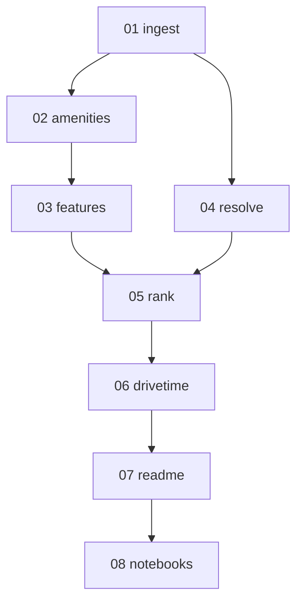

# Implementation report: catalog-and-ranker

- **PRD:** `.scratch/catalog-and-ranker/PRD.md`
- **Started-at:** 2026-09-17T14:56:00+02:00
- **Last-updated:** 2026-09-17T17:50:00+02:00
- **Parallelism cap:** 1
- **Integration branch:** `develop`
- **Harness:** cursor
- **Isolation:** inplace
- **Runner-model:** inherit
- **Implementer-model:** grok (passed `cursor-grok-4.6-xhigh`)
- **Firewall:** intact
- **Preflight:** branch `develop` (not main); tree clean except this report; `uv` 0.11.13; `/implement` present; tdd + code-review present; PRD present. User requested cap=1 sequential on `develop`.

## Status table

| ID | Title | Wave | Status | Agent ID | Worktree SHA | Integrated SHA | Started | Finished | Notes |
| --- | --- | --- | --- | --- | --- | --- | --- | --- | --- |
| 01-ingest-fixture-catalog | Ingest a fixture OSM file into a Catalog of DayHikes | 1 | committed | a2e693c9-6d42-403b-909e-f66bdf5e4a01 | abae43e | abae43e | 2026-09-17T14:57:00+02:00 | 2026-09-17T15:20:00+02:00 | inplace |
| 02-trailhead-amenity-facts | AmenityFacts around each Trailhead | 2 | committed | d0cf127d-be40-4c58-9362-61b8cef08ad1 | a396498 | a396498 | 2026-09-17T15:20:00+02:00 | 2026-09-17T15:40:00+02:00 | inplace |
| 04-resolve-seed-names | Resolve Seed names against the Catalog | 3 | committed | 85d5f2e3-e32e-48e1-ba9e-e35f510b5868 | 6af45e7 | 6af45e7 | 2026-09-17T15:40:00+02:00 | 2026-09-17T16:00:00+02:00 | inplace |
| 03-feature-vectors | FeatureVectors on each DayHike | 4 | committed | c82890c0-c8e8-4818-ad3d-0ae375202078 | 712230d | 712230d | 2026-09-17T16:00:00+02:00 | 2026-09-17T16:20:00+02:00 | inplace |
| 05-rank-by-seed-similarity | Rank DayHikes by maximum similarity to Seeds | 5 | committed | 62d78ede-3100-4d6d-93d4-2b0aea2ffec5 | 59a113f | 59a113f | 2026-09-17T16:20:00+02:00 | 2026-09-17T16:45:00+02:00 | inplace |
| 06-filter-ranking-by-drivetime | Filter a Ranking by DriveTime from Origin | 6 | committed | 7d45151a-1b9e-40e6-887d-c2f95e6f2e94 | 7b42466 | 7b42466 | 2026-09-17T16:45:00+02:00 | 2026-09-17T17:10:00+02:00 | inplace |
| 07-readme-and-api-docs | README and public-API documentation | 7 | committed | ec6ab8bb-f810-411f-a794-84bce3f0bfe8 | 791ae62 | 791ae62 | 2026-09-17T17:10:00+02:00 | 2026-09-17T17:30:00+02:00 | inplace |
| 08-demonstration-notebooks | Demonstration notebooks | 8 | committed | fff6845c-669f-466e-938b-97c238d54bb5 | c42b93c | c42b93c | 2026-09-17T17:30:00+02:00 | 2026-09-17T17:50:00+02:00 | inplace |

## Dependency graph

## Wave plan

cap=1 sequential inplace. Implementer for every issue: grok → `cursor-grok-4.6-xhigh`.

1. Wave 1: `01-ingest-fixture-catalog`
2. Wave 2: `02-trailhead-amenity-facts`
3. Wave 3: `04-resolve-seed-names`
4. Wave 4: `03-feature-vectors`
5. Wave 5: `05-rank-by-seed-similarity`
6. Wave 6: `06-filter-ranking-by-drivetime`
7. Wave 7: `07-readme-and-api-docs`
8. Wave 8: `08-demonstration-notebooks`

## Activity log

- 2026-09-17T14:56:00+02:00 preflight passed; initial pending rows written.
- 2026-09-17T15:20:00+02:00 wave 1 committed 01 at abae43e (implementer a2e693c9).
- 2026-09-17T15:40:00+02:00 wave 2 committed 02 at a396498 (implementer d0cf127d).
- 2026-09-17T16:00:00+02:00 wave 3 committed 04 at 6af45e7 (implementer 85d5f2e3).
- 2026-09-17T16:20:00+02:00 wave 4 committed 03 at 712230d (implementer c82890c0).
- 2026-09-17T16:45:00+02:00 wave 5 committed 05 at 59a113f (implementer 62d78ede).
- 2026-09-17T17:10:00+02:00 wave 6 committed 06 at 7b42466 (implementer 7d45151a).
- 2026-09-17T17:30:00+02:00 wave 7 committed 07 at 791ae62 (implementer ec6ab8bb).
- 2026-09-17T17:50:00+02:00 wave 8 committed 08 at c42b93c (implementer fff6845c). Wave-runner 44428f26.
- 2026-09-17T17:50:00+02:00 all waves dispatched. `uv run pytest`: 51 passed. No leftover issue worktrees.

## Outstanding follow-ups

- Way-tagged amenities are uncounted (node amenities only).
- Trailhead picker remains the first LineString node from ticket 01.
- README documents XML fixture ingest rather than a PBF CLI.
- Web UI is out of this PRD (see `docs/future-work.md`); notebooks are the demo.

## Resume instructions

Re-run `/implement-issues .scratch/catalog-and-ranker/ --cap 1 --isolation inplace`. Phase 2 will mark all eight issues committed from `issues/done/` and `<id>:` commits on `develop`.
