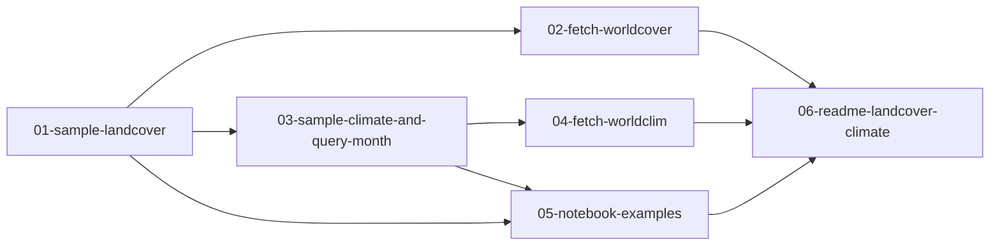

# Implementation report: landcover-and-climate

Feature: LandCover and ClimateNormal
PRD: [PRD.md](PRD.md)
started-at: 2026-09-22T21:19:54+0200
last-updated: 2026-09-22T23:25:00+0200
parallelism cap: 1
integration branch: landcover-and-climate
harness: cursor
isolation: inplace
runner-model: inherit
implementer-model: grok (passed cursor-grok-4.6-xhigh)
firewall: degraded

Preflight assumptions: working tree was clean; `uv` 0.11.13; `/implement`, tdd, and code-review skills are present. `data/landcover/` is gitignored by issue 02. `data/climate/` is not gitignored yet — issue 04 adds that line. In-place commits need git write permission. Cap 1 splits each dependency wave into one issue. Nested wave-runner Task only allows `composer-2.5-fast`, so the orchestrator dispatches `issue-implementer` directly (firewall degraded).

## Status table

| ID | Title | Wave | Status | Agent ID | Worktree SHA | Integrated SHA | Started | Finished | Notes |
| --- | --- | --- | --- | --- | --- | --- | --- | --- | --- |
| 01-sample-landcover | Sample LandCover onto the GeometryStore and into Ranking | 1 | committed | f46bed5a-f935-4e5f-b464-b730a61377f9 | 8923f1caf6a47c3255a613b906a4c8512248b5c1 | 8923f1caf6a47c3255a613b906a4c8512248b5c1 | 2026-09-22T21:19:54+0200 | 2026-09-22T21:45:00+0200 | inplace; issue file in done/ |
| 02-fetch-worldcover | Fetch ESA WorldCover tiles for the Catalog bbox | 2 | committed | ccdf602e-34da-4a8c-921e-428d620832a6 | d04664453ed55fb810405c82d45fa055cfe8c299 | d04664453ed55fb810405c82d45fa055cfe8c299 | 2026-09-22T21:45:00+0200 | 2026-09-22T22:05:00+0200 | inplace; issue file in done/ |
| 03-sample-climate-and-query-month | Sample ClimateNormal and rank with an optional QueryMonth | 3 | committed | 5db29327-7233-4c8d-be07-7ec4301c6bf1 | 25b9df8482fb3f26b9cc722fa2b70ec543333a93 | 25b9df8482fb3f26b9cc722fa2b70ec543333a93 | 2026-09-22T22:05:00+0200 | 2026-09-22T22:30:00+0200 | inplace; issue file in done/ |
| 04-fetch-worldclim | Fetch WorldClim monthly normals for the Catalog bbox | 4 | committed | b077a631-ab0b-4593-a280-1bbf88956638 | 7aed9d39a36f8e753cbc09d7031b54d46982f9e8 | 7aed9d39a36f8e753cbc09d7031b54d46982f9e8 | 2026-09-22T22:30:00+0200 | 2026-09-22T22:50:00+0200 | inplace; issue file in done/ |
| 05-notebook-examples | Show LandCover and QueryMonth in the notebook walkthrough | 5 | committed | d5a9dbf7-74db-48be-baa9-4e541016e066 | 15c74d06ed256226da1305d8e1c204210461ce71 | 15c74d06ed256226da1305d8e1c204210461ce71 | 2026-09-22T22:50:00+0200 | 2026-09-22T23:10:00+0200 | inplace; issue file in done/ |
| 06-readme-landcover-climate | Document LandCover and ClimateNormal like elevation | 6 | committed | dea9b64d-58fd-433e-9da6-e96738d2d403 | ac7d6138758c705fa085f84bcf02944caca76e23 | ac7d6138758c705fa085f84bcf02944caca76e23 | 2026-09-22T23:10:00+0200 | 2026-09-22T23:25:00+0200 | inplace; issue file in done/ |

## Dependency graph

## Wave plan

Cap 1, isolation inplace. Every implementer is grok → `cursor-grok-4.6-xhigh`. Runner is inherit. Firewall degraded: orchestrator dispatches implementers.

1. Wave 1: `01-sample-landcover` — grok → cursor-grok-4.6-xhigh
2. Wave 2: `02-fetch-worldcover` — grok → cursor-grok-4.6-xhigh
3. Wave 3: `03-sample-climate-and-query-month` — grok → cursor-grok-4.6-xhigh
4. Wave 4: `04-fetch-worldclim` — grok → cursor-grok-4.6-xhigh
5. Wave 5: `05-notebook-examples` — grok → cursor-grok-4.6-xhigh
6. Wave 6: `06-readme-landcover-climate` — grok → cursor-grok-4.6-xhigh

## Activity log

- 2026-09-22T21:19:54+0200 preflight pass. BASE_BRANCH=landcover-and-climate. No prior report, no issue worktrees.
- 2026-09-22T21:19:54+0200 01-sample-landcover pending → in-progress. isolation=inplace.
- 2026-09-22T21:25:00+0200 wave-runner 50449149-9122-48ed-9007-44fe810567f1 returned failed: nested Task rejected cursor-grok-4.6-xhigh (allowed composer-2.5-fast). firewall: degraded. Orchestrator will dispatch issue-implementer.
- 2026-09-22T21:45:00+0200 01-sample-landcover committed inplace 8923f1caf6a47c3255a613b906a4c8512248b5c1. Agent f46bed5a-f935-4e5f-b464-b730a61377f9.
- 2026-09-22T21:45:00+0200 02-fetch-worldcover pending → in-progress. isolation=inplace.
- 2026-09-22T22:05:00+0200 02-fetch-worldcover committed inplace d04664453ed55fb810405c82d45fa055cfe8c299. Agent ccdf602e-34da-4a8c-921e-428d620832a6.
- 2026-09-22T22:05:00+0200 03-sample-climate-and-query-month pending → in-progress. isolation=inplace.
- 2026-09-22T22:30:00+0200 03-sample-climate-and-query-month committed inplace 25b9df8482fb3f26b9cc722fa2b70ec543333a93. Agent 5db29327-7233-4c8d-be07-7ec4301c6bf1.
- 2026-09-22T22:30:00+0200 04-fetch-worldclim pending → in-progress. isolation=inplace.
- 2026-09-22T22:50:00+0200 04-fetch-worldclim committed inplace 7aed9d39a36f8e753cbc09d7031b54d46982f9e8. Agent b077a631-ab0b-4593-a280-1bbf88956638.
- 2026-09-22T22:50:00+0200 05-notebook-examples pending → in-progress. isolation=inplace.
- 2026-09-22T23:10:00+0200 05-notebook-examples committed inplace 15c74d06ed256226da1305d8e1c204210461ce71. Agent d5a9dbf7-74db-48be-baa9-4e541016e066.
- 2026-09-22T23:10:00+0200 06-readme-landcover-climate pending → in-progress. isolation=inplace.
- 2026-09-22T23:25:00+0200 06-readme-landcover-climate committed inplace ac7d6138758c705fa085f84bcf02944caca76e23. Agent dea9b64d-58fd-433e-9da6-e96738d2d403.
- 2026-09-22T23:25:00+0200 all waves done. No issue worktrees to remove.

## Outstanding follow-ups

- 01: `sample_landcover` matches rasters by GeoTIFF bounds, not WorldCover 3×3 tile ids. Fetch writes `ESA_WorldCover_10m_2021_v200_<tile>_Map.tif`, which sample globs by bounds.
- 02: README `fetch-landcover` docs remain issue 06.

## Resume instructions

Re-run implement-issues on `.scratch/landcover-and-climate`. Phase 2 reconciles this report, `done/` issue files, and `<id>:` commits on `landcover-and-climate`.
