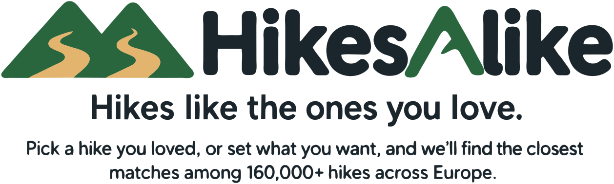
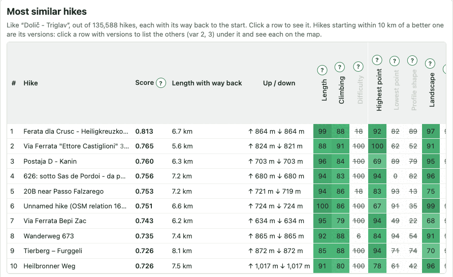
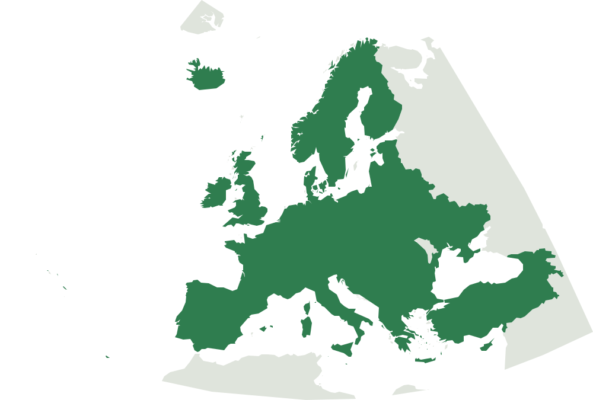

<p align="center">
  
</p>

# HikesAlike

**Hikes like the ones you love.**

Tell HikesAlike about a hike you enjoyed, and it finds other hikes across
Europe that feel the same: similar length, climb, scenery and weather. No hike
in mind? Describe the one you want instead.

**[Try it now](https://dayhike-445079235401.europe-west1.run.app)**: free, no
account, no ads. If nobody has used it lately, the first page can take up to
about 20 seconds while the server wakes up.

<p>
  
</p>

*Loved the climb from Dolič to Triglav? Here are the 10 most similar hikes, out
of over 130,000 in Europe.*

- **Where:** Europe, wherever OpenStreetMap maps hiking routes: very good in
  the Alps and central Europe, thinner in the east and south-east.
- **Finding ideas, not navigating:** always check conditions and maps before
  you go ([safety](src/dayhike/web/static/terms.html)).
- **Open source,** made by [mjordanic](https://github.com/mjordanic).
  Questions? [Open an issue](https://github.com/mjordanic/outdoors_destinations/issues).

You can also say where you are starting from and how far you are willing to
drive, for example "within 2 hours of Munich".

<p>
  
</p>

Shaded areas are where we have hikes.

**More:** [How to use the site](docs/user-guide.md) · **For developers:**
[Technical docs](docs/technical.md)

## Run it yourself

You can also run it on your own computer. With [uv](https://docs.astral.sh/uv/):

```bash
uv sync
uv run pytest
```

Building the hike data and starting the web demo are in the
[technical docs](docs/technical.md).

## Licence

The code is under the MIT licence ([LICENSE](LICENSE)). The data has its own
licences ([DATA-LICENSES.md](DATA-LICENSES.md),
[Attribution](docs/technical.md#attribution)).
