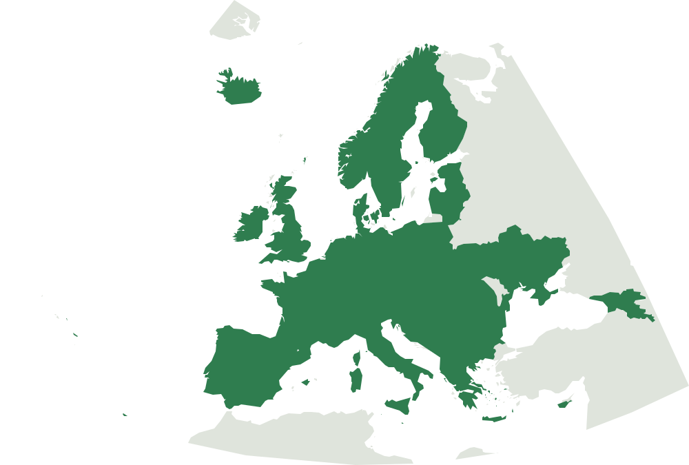

# DayHike catalog

<p>
  
  
</p>

**[Live demo](https://dayhike-445079235401.europe-west1.run.app)**: the
read-only web demo, running on Google Cloud Run. After it has been idle, the
first visit takes about 10-12 s to start.

A local Catalog of DayHikes from OpenStreetMap, ranked by similarity to Seeds
you already know. DriveTime is an optional query-time filter from today's
Origin. DriveTime is not a FeatureVector column.

This is a Python package plus SQLite files on disk. There is no live Overpass
query and no database server to start. You ingest an OSM snapshot once,
optionally sample a DEM, LandCover, and climate onto the geometries, build the
similarity facts once, then rank from those files. A small read-only web demo
serves a trimmed export of them ([Web demo](#web-demo)).

The map shows the coverage of the current Catalog: land with at least 10
Trailheads and 0.2 per 1,000 km² is shaded (`dayhike coverage-map`, below).

## Install

```bash
uv sync
```

The package is `dayhike`. Tests: `uv run pytest`. Checks on the real data in
`data/` are opt-in: `DAYHIKE_REAL_DATA=1 uv run pytest -m real_data`
(see [Tests](#tests) and [Clean rebuild](#clean-rebuild)).

## How data is created (command order)

Nothing useful exists after `uv sync` except the tiny committed fixture.
Every real file under `data/` is built by a command. This is the order:

```
1. OSM snapshot          data/osm/*.osm.pbf          fetch-extracts (or curl)
2. Ingest                data/catalog.sqlite         dayhike ingest
                         data/catalog.geometry.sqlite     (always, same ingest)
                         data/catalog.trailgraph.sqlite   (always, same ingest)
3. DEM rasters           data/dem/*_FABDEM_V1-2.tif  dayhike fetch-dem
4. Sample heights        updates both SQLite files   dayhike sample-dem
5. LandCover rasters     data/landcover/*.tif        dayhike fetch-landcover
6. Sample LandCover      updates both SQLite files   dayhike sample-landcover
7. Climate rasters       data/climate/*.tif          dayhike fetch-climate
8. Sample climate        updates both SQLite files   dayhike sample-climate
8b. Sample TrailGraph    updates the TrailGraph      dayhike sample-trailgraph (ways back, composing hikes)
9. Similarity facts      data/catalog.similarity/    dayhike build-similarity
10. Rank                 stdout scores               dayhike rank [--weight] [--month] [--one-way]
11. Optional DriveTime   local Valhalla Docker       rank --origin --max-hours, nearby
12. Web demo export      data/web-serving/           dayhike export-serving (see Web demo)
```

```bash
uv sync
mkdir -p data/osm data/dem data/landcover data/climate

# 1. Snapshot (Geofabrik PBF). Ranking never talks to OpenStreetMap.
uv run dayhike fetch-extracts --dest data/osm

# 2. Catalog + GeometryStore + TrailGraph. One command writes the three SQLite files.
uv run dayhike ingest data/osm --catalog data/catalog.sqlite

# 3–4. Elevation. Skip these if OSM ele on nodes is enough (it usually is not).
uv run dayhike fetch-dem          # default bbox: Alps + Dinarides
uv run dayhike sample-dem         # writes heights into the two SQLite files

# 5–8. LandCover and climate. Skip these if length, elevation, and amenities are enough.
uv run dayhike fetch-landcover    # ESA WorldCover 2021 tiles
uv run dayhike sample-landcover
uv run dayhike fetch-climate      # CHELSA V2.1 monthly normals
uv run dayhike sample-climate
uv run dayhike sample-trailgraph  # the same rasters onto the TrailGraph, for composed hikes

# 9. Similarity facts and Calibration of every DayHike, once (rerun after 2–8).
uv run dayhike build-similarity

# 10. Rank by Seed (no Valhalla). Omit --month for the June–August climate regime.
uv run dayhike rank --catalog data/catalog.sqlite "Exact Name From The Catalog"

# 11. Optional: car DriveTime filter (needs Docker Valhalla, see below).
uv run dayhike rank --catalog data/catalog.sqlite \
  --origin 45.8,15.97 --max-hours 2 \
  "Exact Name From The Catalog"
```

What each step **does not** do:

| Step | Writes | Does not |
| --- | --- | --- |
| `fetch-extracts` | `data/osm/*.pbf` | Catalog, GeometryStore, DEM |
| `ingest` | Catalog + GeometryStore + TrailGraph from the PBF | download OSM; download rasters; talk to Valhalla |
| `fetch-dem` | GeoTIFFs in `data/dem/` | touch SQLite; sample heights |
| `sample-dem` | `vertices.ele` + Catalog elevation | download rasters; rewrite hike list |
| `fetch-landcover` | GeoTIFFs in `data/landcover/` | touch SQLite; sample classes |
| `sample-landcover` | `vertices.landcover` + Catalog fractions | download rasters; rewrite hike list |
| `fetch-climate` | GeoTIFFs in `data/climate/` | touch SQLite; sample climate |
| `sample-climate` | Catalog monthly means (drops an old `vertex_climate`) | download rasters; rewrite hike list |
| `sample-trailgraph` | per-vertex height, LandCover, climate cell, southness and water cells in the TrailGraph | touch the Catalog or GeometryStore; download rasters |
| `build-similarity` | `data/catalog.similarity/` (facts + Calibration, one way and with the way back) | touch any SQLite file; download anything |
| `rank` | nothing on disk | fetch OSM or rasters; rebuild facts |

Ingest **replaces** the Catalog (it does not append). `sample-dem`,
`sample-landcover`, and `sample-climate` do **not** replace the Catalog: they
only overwrite sampled columns on hikes whose geometry sits on a downloaded
tile. `build-similarity` reads both SQLite files, FABDEM, the WorldCover
tiles (for `waterside`) and the sampled TrailGraph (for each DayHike's way back) and replaces `data/catalog.similarity/`; ingest and every sample step that changes the
Catalog or the TrailGraph delete that directory, so rerun `build-similarity` after them (Ranking
refuses missing facts and facts built for other DayHikes, other Catalog
values or by other code).

For a continent PBF (for example `europe-latest.osm.pbf`), ingest is the same
command. After ingest, widen raster coverage with
`dayhike fetch-dem --bounds south,west,north,east` (same `--bounds` on
`fetch-landcover` and `fetch-climate`) then sample again.

Nothing is fetched from the network at rank time except that optional Valhalla
call on your machine.

## Where files live

| Path | What it is | In git? |
| --- | --- | --- |
| `tests/fixtures/catalog.osm` | Tiny OSM XML **oracle** for tests and demos | yes |
| `data/catalog.sqlite` | The Catalog you work with (SQLite database) | **gitignored** |
| `data/catalog.geometry.sqlite` | GeometryStore: DayHikeGeometry + raw amenities | **gitignored** |
| `data/catalog.trailgraph.sqlite` | TrailGraph: the marked hiking network as Junctions and Segments | **gitignored** |
| `data/catalog.similarity/` | Similarity facts + Calibration (numpy arrays) | **gitignored** |
| `data/osm/` | Geofabrik / osmium extracts you download | gitignored |
| `data/valhalla/` | Road PBF + Valhalla routing tiles Docker builds | gitignored |
| `data/web-serving/` | Serving export for the web demo (`export-serving`) | **gitignored** |
| `src/dayhike/web/static/` | The demo page, its script, the logo and the coverage map | yes |
| `web/` | Dockerfile, local compose file and smoke script of the demo | yes |
| `data/valhalla/compose.yaml` | How to run Valhalla | yes |
| `data/valhalla/prepare-roads.sh` | osmium filter: car roads only, no buildings | yes |
| `data/valhalla/prepare-highways.sh` | osmium filter: motorway/trunk/primary only | yes |
| `data/catalog.snaps.npz` | Where Trailheads snap onto the highway tiles (`--highways` cache, a few MB) | **gitignored** |
| `data/valhalla/mjolnir.drive-time.json` | Valhalla flags: no walk/bike/driveways | yes |
| `data/valhalla/*.osm.pbf` | Road extract for tiles | **gitignored** |
| `data/dem/` | FABDEM 1° GeoTIFFs for elevation | **gitignored** |
| `data/landcover/` | ESA WorldCover 2021 map GeoTIFFs | **gitignored** |
| `data/climate/` | CHELSA V2.1 monthly GeoTIFFs | **gitignored** |

`uv sync` does **not** download OSM and does **not** install Valhalla. Tests
never read `data/` and never start Docker. They rebuild a Catalog in a temp
directory from the committed fixture.

## The fixture is slim on purpose

`tests/fixtures/catalog.osm` is not a Croatia extract. It is a hand-built OSM
XML file with hiking relations so ingest and ranking have a known answer:

| OSM relation | Name | What happens |
| --- | --- | --- |
| 1001 | Ridge Walk | **Kept.** ~10 km, `sac_scale=mountain_hiking`, Hut/cafe/parking/water within 20 km of the Trailhead, elevation tags on nodes. A disconnected extra member is skipped (`unconnected_m` ≈ 1 km). |
| 1002 | Valley Path | **Kept.** ~5 km, no `sac_scale`, no nearby amenities, no `ele`. |
| 1003 | `relation:1003` | **Kept.** No OSM `name`. `name_origin=synthetic`. |
| 1004 | Long Traverse | Dropped: ~30 km, outside the 1–20 km band (`dropped_length`). |
| 1005 | Via Dinarica Red | Dropped: `network=iwn` superroute (`dropped_network`). |
| 1006 | Fifty Km Walk | Dropped: ~50 km (`dropped_length`). |
| 1007 | PS-1 | **Kept.** OSM `ref` only (`name_origin=osm_ref`). |

That is why `tests/fixtures/` looks small: the PRD uses it as the oracle, not as
the hiking dataset. A real Catalog comes from Geofabrik extracts (see below).

## 1. Build a Catalog from the fixture

```bash
uv sync
mkdir -p data
uv run dayhike ingest tests/fixtures/catalog.osm --catalog data/catalog.sqlite
```

Stdout is the Catalog path and the ingest report (numbers are metres; length is
a hair over 10 km / 5 km because it is computed on the sphere):

```
data/catalog.sqlite
IngestReport(kept=4, dropped_unnamed=0, dropped_length=2, dropped_network=1, named_osm_name=2, named_osm_ref=1, named_synthetic=1, dropped_node_network=0, named_from_to=0, named_place=0)
```

Progress (`filter:`, `relations:`, `ways:`, `nodes:`, `assemble:`, `write:`,
`trailgraph:`) goes to **stderr**. The same command also writes
`data/catalog.geometry.sqlite` and `data/catalog.trailgraph.sqlite`
(`--snap-tolerance` sets the TrailGraph's snap tolerance, above 0 and at most 50 m, checked before ingest starts). Add `--list` to print kept DayHikes as
`id`, name, `length_m`. `--fresh` ignores a leftover work file and starts
again.

Same thing from Python:

```python
from dayhike import build_catalog

catalog = build_catalog("tests/fixtures/catalog.osm", "data/catalog.sqlite")
print(catalog.ingest_report)
for hike in catalog.dayhikes:
    print(hike.id, hike.name, hike.length_m, hike.difficulty.sac_scale)
```

`build_catalog` **replaces** the SQLite file if it already exists; it does not
append. The previous Catalog stays on disk until the new file is complete. XML
and PBF are both accepted (pyosmium). Multiple files (or a directory) in
**one** run become one Catalog. See **Ingest replaces the Catalog** below if
you ingest more than one country.

Walk through stages, keep/drop, and resume after a kill in
[`notebooks/01_raw_data_and_ingestion.ipynb`](notebooks/01_raw_data_and_ingestion.ipynb).

## 2. Open the Catalog later (it is a SQLite database)

After ingest, the Catalog is an ordinary SQLite file. You do not run Postgres
or SQLite server. Either load it through the package, or query SQL yourself.

### Python objects

```python
from dayhike import Catalog, resolve_seed

catalog = Catalog.open("data/catalog.sqlite")
print(catalog.attribution)
print(catalog.ingest_report)

ridge = next(hike for hike in catalog.dayhikes if hike.name == "Ridge Walk")
print(ridge.id, ridge.trailhead.latitude, ridge.trailhead.longitude)
print(ridge.trailhead.amenity_facts)
print(ridge.feature_vector)

print(resolve_seed(catalog, "ridge walk"))  # 1001; case-insensitive exact match
```

`Catalog.open` reads these tables into memory:

| Table | Contents |
| --- | --- |
| `dayhikes` | OSM relation id, Seed label, `name_origin`, length_m, Difficulty (`sac_scale` or NULL) |
| `trailheads` | lat/lon used for amenities and DriveTime |
| `amenity_facts` | per DayHike: hut, parking, restaurant_cafe, drinking_water (count + nearest_m) |
| `feature_vectors` | length, elevation min/max/gain, Difficulty ordinal, LandCover fractions, regime climate |
| `climate_months` | hike-level monthly temperature (°C), precipitation (mm), solar radiation |
| `labels` | vacant (`hiker_id`, `dayhike_id`, `score`, `created_at`) for a later website |
| `catalog_meta` | OSM attribution and the ingest report JSON |

Zero amenity counts are stored (Valley Path has four rows with `count=0`).
Missing elevation, missing `sac_scale`, missing LandCover fractions, and
missing climate are SQL NULL, not zero.

Ranking reads this file and the similarity facts beside it
(`data/catalog.similarity/`, see [3. Rank by Seed](#3-rank-by-seed)).
Polylines and raw amenity points live in the GeometryStore beside it.

## GeometryStore (written at ingest, not downloaded)

The GeometryStore is a sidecar SQLite file. It is **not** pulled from a
server. `dayhike ingest` always writes it next to the Catalog:
`data/catalog.sqlite` → `data/catalog.geometry.sqlite`
(`geometry_store_path_for`). There is no fetch-geometry command. Rank does
not read it. If you only have `catalog.sqlite`, re-run ingest; `sample-dem`,
`sample-landcover`, and `sample-climate` cannot create the sidecar by themselves.

It holds **Catalog DayHikes only** (dropped length/network relations are
absent):

| Table | Contents |
| --- | --- |
| `dayhikes` | id, Seed label, `name_origin`, length, `unconnected_m`, Difficulty, member list, relation tags |
| `vertices` | ordered DayHikeGeometry: `seq`, OSM `node_id`, lat, lon, `ele`, `landcover` |
| `ways` | member ways in listed order: node id lists, way tags, `in_chain` (1 when any part of the way is walked), `leftover` (the reason when not), `walked_m`, `walk_order` |
| `amenities` | raw points: OSM id, kind, lat, lon, tags |
| `geometry_meta` | OSM attribution; WorldCover and CHELSA after those samples |

DayHikeGeometry is the main walk of the member-way graph: each distinct member
way once, from the Trailhead, with no jump between consecutive ways except a
joined gap of 50 m or less. Member ways not on the walk are Leftovers. They
stay in `ways` with `in_chain = 0` and a `leftover` reason (`role`, `repeat`,
`disconnected`, `dead_end`, `shortcut`), and `dayhikes.unconnected_m` is their
distinct length. Catalog `length_m` and `vertices` follow the walk only. See
[`docs/adr/0012-main-walk-of-member-way-graph.md`](docs/adr/0012-main-walk-of-member-way-graph.md),
which supersedes ADR-0009.

At ingest, `vertices.ele` is OSM `ele` on that node, or NULL, and
`vertices.landcover` is NULL. After
`sample-dem`, vertices that sit on a FABDEM tile get raster heights in
metres. After `sample-landcover`, covered vertices get a WorldCover class
code (10 tree, 20 shrub, 30 grass, 60 bare, 70 permanent snow; other codes
stay in the leftover share). Vertices with no covering tile stay unset.
Climate is not stored per vertex: `sample-climate` writes only the Catalog's
hike-level means. Amenities include hut, parking, restaurant/cafe, drinking
water, Viewpoint, Peak, Shelter, and the other WaterSources (spring, water tap,
water point). Catalog AmenityFacts still use only the first four kinds, counted
from the Trailhead.

```bash
sqlite3 data/catalog.geometry.sqlite \
  'SELECT dayhike_id, seq, latitude, longitude, ele, landcover FROM vertices LIMIT 5;'
sqlite3 data/catalog.geometry.sqlite \
  'SELECT kind, COUNT(*) FROM amenities GROUP BY 1;'
```

Load the tables as GeoPandas in
[`notebooks/04a_geometry.ipynb`](notebooks/04a_geometry.ipynb).
`build-similarity` turns it into similarity facts; try a new fact as a Measure
in [`notebooks/04_rank_feature_lab.ipynb`](notebooks/04_rank_feature_lab.ipynb).
`rank_dayhikes` does not read it.

Pandas, maps, and DayHike objects:
[`notebooks/02_catalog.ipynb`](notebooks/02_catalog.ipynb).

### Query the Catalog with SQL

```bash
uv run python -c "
import sqlite3
c = sqlite3.connect('data/catalog.sqlite')
c.row_factory = sqlite3.Row
for row in c.execute('SELECT id, name, length_m, difficulty FROM dayhikes'):
    print(dict(row))
for row in c.execute('SELECT * FROM amenity_facts WHERE dayhike_id = 1001'):
    print(dict(row))
"
```

Or with the `sqlite3` CLI if you have it:

```bash
sqlite3 data/catalog.sqlite 'SELECT id, name, length_m FROM dayhikes;'
```

Do not hand-edit FeatureVectors and expect Ranking to follow unless you rerun
`dayhike build-similarity`. The supported write paths are `build_catalog` /
`dayhike ingest` (full Catalog), `dayhike sample-dem` (elevation columns),
`dayhike sample-landcover` (LandCover fractions), and `dayhike sample-climate`
(climate columns and monthly table), each followed by `build-similarity`.

## TrailGraph (written at ingest, for composed hikes)

`dayhike ingest` also writes `data/catalog.trailgraph.sqlite`
(`trailgraph_path_for`) from the ingest work file, so there is no extra OSM
pass. It holds the marked hiking network: every member way of every
`route=hiking` relation ingest read, **including** the relations it dropped
(too short, too long, superroutes, node-network legs). Unmarked paths are not
in it. Ways split into Segments that meet at Junctions: a node two ways share,
a dead end, a node where the relations along the trail change (a stage
boundary), or a crossing of two same-layer ways with no node. A dead-end tip
within `--snap-tolerance` (20 m by default, at most 50 m) of a node more than
three times that far away along the network is joined by a `gap` Segment,
never across a bridge, tunnel or layer. Two ways that pass that close with no
join nearer than 100 m along the network get a `link` Segment, offered in the
web demo as "connect here" and never walked unless picked. See
[`docs/adr/0018-trailgraph-and-composed-hikes.md`](docs/adr/0018-trailgraph-and-composed-hikes.md).

| Table | Contents |
| --- | --- |
| `junctions` | id (the OSM node id; a crossing is negative), lat, lon, degree, and `key`, its name in a shared link (the OSM node id, or `c{lat}_{lon}` in 1e-7 degrees for a crossing) |
| `segments` | id, kind (`trail`, `gap`, `link`), Junctions `a` and `b`, length, strictest `sac_scale`, OSM way and relation ids, node ids, vertices as packed arrays: coordinates (1e-7 degree integers), `ele`, `landcover`, `climate_cell`, `southness`, per-way runs of steps (`parts`: way, negative against its node order, metres, surface, steps, `sac_scale`), and `step_ab` / `step_ba`, how a shared link names it walked from `a` and from `b` |
| `segment_boxes` | R*Tree of each Segment's bounding box |
| `segment_ways` | the Segments of each OSM way, for resolving a shared link |
| `relations` | id, name, ref and network of the relations on the Segments |
| `amenities`, `amenity_boxes` | the amenity points the Measures count near the network, with an R*Tree |
| `climate_cells` | 12 months x 3 CHELSA values per cell, after `sample-trailgraph` |
| `water_tiles`, `water_cells` | the WorldCover cells beside open water near the network, for WaterSide |
| `trailgraph_meta` | OSM attribution, snap tolerance, Link distance, and the CHELSA grid after `sample-trailgraph` |

At ingest `ele` is OSM `ele` and the other per-vertex arrays are unset.
`sample-trailgraph` reads the same FABDEM, WorldCover and CHELSA rasters as
the other sample steps, so a server without rasters can compute a composed
hike's facts with the same rules as a DayHike's. It does not touch the Catalog
and needs rerunning after every ingest: `export-serving` refuses a TrailGraph
it never ran on when the similarity facts read the rasters. The way back of
every DayHike reads these samples too (ADR-0019), so it deletes the similarity
facts: run it before `build-similarity`. On Slovenia the
file is about 38 MB, and so is its copy in the serving export.

## 3. Rank by Seed

Seed names must exist in the Catalog (unknown or ambiguous names fail; there
is no fuzzy lookup). The Seed itself is omitted from the result list.

Ranking compares the Seed with every DayHike on **Measures**: one fact each,
scored 1 (alike) to 0 (unlike). The Hiker weighs each Measure 0–100; a Measure
left out or at 0 is excluded. Each Measure score is **calibrated** first (the
share of random DayHike pairs that score lower on it), then the weighted mean
over the Measures both DayHikes have is the similarity (ADR-0013). Several
Seeds: a candidate's similarity is its **best** Seed's, not the mean. Of
DayHikes that follow the same route (**Twins**, ADR-0016) only the best is
listed, and none of a Seed's Twins.

The facts come from `dayhike build-similarity`, which writes them once with the
Calibration into `data/catalog.similarity/`. Ranking reads that directory and
the Catalog, never the GeometryStore, and rebuilds nothing per query.

**Return to start** (ADR-0019, on by default). Every hike is measured with its
way back to its Trailhead: the Seed, a composed Seed and every DayHike it is
compared with alike. The way back is the shortest one: none for a loop that
ends where it starts, a straight step for ends at most 50 m apart, else the
shortest walk over the TrailGraph's trails when it is shorter than the hike
itself backwards, else the hike retraced. So a hike that ends 500 m from its
start adds about 500 m, and a line up to a summit is compared up and back:
twice the length, its climb and its descent both ways. `build-similarity`
stores a second set of facts with the way back, calibrated on its own, and
how each DayHike gets back (`way_back.npy`: metres back, climb and descent of
the whole walk, kind). `--one-way` (`return_to_start=False` in Python, the
API and the page) compares every hike one way, as the Catalog stores it.

Walk through one Seed, Measure weights, two Seeds (max-not-mean), unknown
names, a stubbed DriveTime filter, Ranking with no month and with QueryMonth
7, and LandCover order in
[`notebooks/03_ranking.ipynb`](notebooks/03_ranking.ipynb). Try a new fact as a
Measure in [`notebooks/04_rank_feature_lab.ipynb`](notebooks/04_rank_feature_lab.ipynb).
See every Measure and its Calibration on the real Catalog in
[`notebooks/05_similarity.ipynb`](notebooks/05_similarity.ipynb).

```bash
uv run dayhike build-similarity --catalog data/catalog.sqlite   # once; --dem data/dem/, --landcover data/landcover/
uv run dayhike rank --catalog data/catalog.sqlite "Ridge Walk"
uv run dayhike rank --catalog data/catalog.sqlite \
  --weight highest=100 --weight profile=50 --weight hut_along=30 "Ridge Walk"
uv run dayhike rank --catalog data/catalog.sqlite --month 7 "Ridge Walk"
```

Prints DayHike id, name, and score (tab-separated), best first:

```
1002	Valley Path	<score>
```

With no `--weight` the eleven core Measures weigh 100 and the others are off:
`length`, `elevation_gain`, `highest`, `lowest`, `profile`, `landcover`,
`temperature`, `precipitation`, `solar_radiation`, `waterside`,
`climb_grade` (ADR-0016). Each `--weight MEASURE=WEIGHT` names one Measure;
the ones not named are excluded. `--limit N` prints only the
best N (every DayHike is still scored). `--one-way` compares every hike one
way instead of with its way back.

### Measures

| Measure | Fact | Kind | Constant |
| --- | --- | --- | --- |
| `length` | Catalog length | ratio | floor 1 km |
| `elevation_gain` | metres climbed, larger of climb and descent (direction-free); a one-vertex DEM spike (10 m+ above or below both neighbours at 25 %+ grade) is dropped, then a change counts once it moves 10 m | ratio | floor 100 m |
| `difficulty` | Difficulty as SAC rank 1–6 | tolerance | D = 3 |
| `highest`, `lowest` | highest and lowest point | tolerance | D = 400 m |
| `profile` | ProfileShape (64 points) | profile | — |
| `landcover` | six LandCover shares (five plus the leftover) | mix | — |
| `peak_summited` | a Peak within 50 m of the line | agree | — |
| `viewpoint_along` | a Viewpoint in the Corridor | agree | — |
| `peaks_around` | Peaks within 2 km of the line | ratio | floor 1 |
| `temperature` | ClimateNormal temperature (regime or QueryMonth) | tolerance | D = 10 °C |
| `precipitation` | ClimateNormal precipitation (regime or QueryMonth) | ratio | floor 10 mm |
| `solar_radiation` | ClimateNormal solar radiation (regime or QueryMonth) | tolerance | D = 5,000 kJ m⁻² day⁻¹ |
| `southness` | SolarAspect from FABDEM (1 south, 0 north) | tolerance | D = 1 |
| `water_count` | WaterSources in the Corridor, capped at 3 | tolerance | D = 3 |
| `dry_stretch` | DryStretch | ratio | floor 1 km |
| `waterside` | WaterSide: share of the walk within 200 m of sea, lake or wide river (WorldCover) | tolerance | D = 0.5, dead band 0.15 (ADR-0021) |
| `hut_along`, `restaurant_cafe_along`, `shelter_along` | that amenity in the Corridor | agree | — |
| `restaurant_cafe_trailhead`, `parking_trailhead` | that amenity within 500 m of the Trailhead | agree | — |
| `surface` | SurfaceMix (paved, gravel, natural, rock) | mix | — |
| `tarmac_approach` | TarmacApproach | tolerance | D = 2 km |
| `round_trip` | RoundTrip | agree | — |
| `climb_grade` | ClimbGrade | ratio | floor 0.03 |
| `steepest_km` | SteepestKm | ratio | floor 50 m |

`ratio` is smaller over larger (each raised to the floor first), `tolerance`
is max(0, 1 − |a − b| / D) with a gap under a dead band counting as 0, `mix`
is the shared share of fractions, `agree` is 1 when two yes/no facts agree
(both absent agrees), `profile` is 1 − the mean
absolute difference of two ProfileShapes, walked either way. A Measure whose
fact is missing on either DayHike drops out of that pair and the other weights
renormalize; a candidate with no weighted Measure scored is left out.

### What the score means

Raw Measure scores sit on very different scales: a random pair of DayHikes
scores 0.6 or more on `profile` nine times in ten, but rarely on `length`.
Calibration maps each raw score to the share of random pairs (100,000, drawn
once from the whole Catalog) that score lower on that Measure, ties counting
half, so every Measure pulls with the weight it is given. Two values that are
equal, or that the Measure counts as equal (a raw score of 1), count their ties
in full and score 1.0 however many random pairs tie with them (ADR-0023). The
printed score is the similarity itself, the weighted mean of the calibrated
Measure scores: a typical random pair scores about 0.5, and 1.0 needs a pair
that no random pair beats on any weighted Measure, so the best matches stay
apart instead of all reading 1.000. Ties in order break on the uncalibrated weighted mean,
then on DayHike id.

Omit `--month` to compare climate as the June–August regime (mean temperature,
mean monthly precipitation, June–August solar radiation). Pass `--month 7` to
compare July instead, calibrated against July's random pairs. QueryMonth is an
integer from 1 to 12. A month before `sample-climate` fails with a message that
climate has not been sampled. Omitting the month never fails for that reason.
LandCover fractions do not change with the month.

### Rebuilding the facts

`build-similarity` rebuilds the facts and the Calibration; run it after ingest
and after every sample step, which delete the old directory.
`build-similarity --calibrate-only` keeps the facts and recomputes the
Calibration only, which is enough after a Measure's constant changes. The
directory records a version of the constants and a digest of the Catalog's
`feature_vectors` and `climate_months`: Ranking fails with a message
naming the command to run when the facts or the Calibration were built by other code, when the Catalog's DayHikes changed, or when a sample step changed their values (a store copied next to a re-sampled Catalog).

Python:

```python
from dayhike import Catalog, rank_dayhikes

catalog = Catalog.open("data/catalog.sqlite")   # opens data/catalog.similarity/ on first rank
ranking = rank_dayhikes(catalog, ["Ridge Walk"])
huts = rank_dayhikes(catalog, ["Ridge Walk"], {"hut_along": 100, "highest": 50})
july = rank_dayhikes(catalog, ["Ridge Walk"], month=7)
nearby = rank_dayhikes(catalog, ["Ridge Walk"], allowed_ids={1002, 1003})
top = rank_dayhikes(catalog, ["Ridge Walk"], limit=50)
for item in ranking.items:
    print(item.dayhike.id, item.dayhike.name, item.score)
```

`allowed_ids` restricts the candidates before scoring (a hook for a DriveTime
pre-filter). Ranking without Origin does not talk to Valhalla.

Unknown name:

```python
from dayhike import UnknownSeedName, rank_dayhikes
rank_dayhikes(catalog, ["Unknown Ridge"])  # raises UnknownSeedName
```

### Similarity at Europe scale

Measured on the Europe Catalog (161,614 DayHikes) on an 8-core Mac:

| What | Measured |
| --- | --- |
| `build-similarity` | 28 min wall, facts 1,701 s including WaterSide and Twins (about 1 min of that); run beside a second build, not on an idle machine; per-phase split and peak memory not yet re-measured. Measuring every DayHike with its way back too (ADR-0019) took Slovenia from 11 s to 37 s; Europe not yet re-measured |
| `build-similarity --calibrate-only` | Calibration 0.6 s |
| `data/catalog.similarity/` | 85 MB: facts 45 MB, ProfileShapes 41 MB, Twins 1.3 MB, ids 1.3 MB, quantiles 0.26 MB |
| `Catalog.open` (once per process) | 4 s, 0.77 GB |
| One Seed, 4–6 weighted Measures, `limit=50` | 0.09–0.12 s |
| One Seed, all 27 Measures, `limit=50` | not yet re-measured (27 Measures) |
| Five Seeds, 4–6 / 27 Measures, `limit=50` | 0.36–0.44 s / not yet re-measured (27 Measures) |
| One Seed, `allowed_ids` of 5,000 DayHikes | 0.03–0.06 s |
| Peak memory of a ranking process | 1.0 GB (0.48 GB without `Catalog.open`) |

So a ranking server fits in 2 GB and is comfortable in 4 GB. Most of its memory
is the Python DayHike objects `Catalog.open` builds; scoring itself needs the
85 MB of memory-mapped arrays plus a few hundred MB per query. Building the
facts needs 1.7 GB (not yet re-measured) and is best run where the
GeometryStore (21 GB) lives, with only `data/catalog.similarity/` and the
Catalog copied to the server.

## 4. Optional Origin and max hours

Pass `--origin` (latitude,longitude) and `--max-hours` together to drop
DayHikes whose DriveTime from Origin exceeds the max (`--limit N` then keeps the
best N reachable DayHikes):

```bash
uv run dayhike rank --catalog data/catalog.sqlite \
  --origin 45.8,15.97 --max-hours 2 \
  "Ridge Walk"
```

That needs a **running** local Valhalla on `http://127.0.0.1:8002` (override
with `--valhalla-url`), built from a car-only roads PBF
(`prepare-roads.sh`). See [docs/valhalla.md](docs/valhalla.md) and
[data/valhalla/compose.yaml](data/valhalla/compose.yaml).

Python, with the real client:

```python
from dayhike import (
    Catalog,
    Origin,
    ValhallaMatrixClient,
    filter_by_drive_time,
    rank_dayhikes,
)

catalog = Catalog.open("data/catalog.sqlite")
ranking = rank_dayhikes(catalog, ["Ridge Walk"])
filtered = filter_by_drive_time(
    ranking,
    Origin(latitude=45.8, longitude=15.97),
    max_hours=2,
    matrix_client=ValhallaMatrixClient("http://127.0.0.1:8002"),
)
for item in filtered.items:
    print(item.dayhike.name, item.score, item.drive_time.hours)
```

Unreachable Trailheads are dropped (no fake DriveTime). Tests stub this HTTP
API; they never build tiles.

No Seeds? `nearby` lists every DayHike within the max DriveTime, nearest
first (id, name, hours):

```bash
uv run dayhike nearby --catalog data/catalog.sqlite --origin 45.8,15.97 --max-hours 4
```

Both commands take `--highways` when Valhalla serves highways-only tiles (all
of Europe, small); the time is then an estimate, see **Highway tiles** below.

The query is cheap for the whole Catalog: Trailheads farther than the max
hours at 140 km/h in a straight line never reach Valhalla, shared Trailhead
spots are one target, and the rest go out nearest first in batches of 2,500
(one source, many targets, `timedistancematrix`). On highways-only tiles
`--highways` does far less: see below.

## Pulling a real extract

Ranking never talks to OpenStreetMap. You download a **frozen snapshot**
(Geofabrik `.osm.pbf`), save it under gitignored `data/osm/`, then run
`dayhike ingest`. That writes `data/catalog.sqlite`. After that you rank from
the SQLite file only.

Do this from the **repo root** after `uv sync`.

### What you are downloading

[Geofabrik](https://www.geofabrik.de/) publishes daily OSM extracts. Index of
Europe: [download.geofabrik.de/europe.html](https://download.geofabrik.de/europe.html).
Each region page has a **`.osm.pbf`** file (binary OSM). That is the file
`dayhike ingest` reads. You do **not** need Overpass, a browser login, or an
API key.

`*-latest.osm.pbf` means “current daily extract,” not a special edition. Sizes
are on each Geofabrik page (typically tens to hundreds of MB per country;
Austria / Switzerland / Bayern / Italy nord-est are the large ones).

### Download links (PRD regions)

Use either the **direct PBF** (curl/wget/`fetch-extracts`) or the **region
page** (browser, shows size and `.md5`).

| Region | Region page | Direct `.osm.pbf` | Filename on disk |
| --- | --- | --- | --- |
| Croatia | [europe/croatia.html](https://download.geofabrik.de/europe/croatia.html) | [croatia-latest.osm.pbf](https://download.geofabrik.de/europe/croatia-latest.osm.pbf) | `croatia-latest.osm.pbf` |
| Slovenia | [europe/slovenia.html](https://download.geofabrik.de/europe/slovenia.html) | [slovenia-latest.osm.pbf](https://download.geofabrik.de/europe/slovenia-latest.osm.pbf) | `slovenia-latest.osm.pbf` |
| Bosnia and Herzegovina | [europe/bosnia-herzegovina.html](https://download.geofabrik.de/europe/bosnia-herzegovina.html) | [bosnia-herzegovina-latest.osm.pbf](https://download.geofabrik.de/europe/bosnia-herzegovina-latest.osm.pbf) | `bosnia-herzegovina-latest.osm.pbf` |
| Montenegro | [europe/montenegro.html](https://download.geofabrik.de/europe/montenegro.html) | [montenegro-latest.osm.pbf](https://download.geofabrik.de/europe/montenegro-latest.osm.pbf) | `montenegro-latest.osm.pbf` |
| Austria | [europe/austria.html](https://download.geofabrik.de/europe/austria.html) | [austria-latest.osm.pbf](https://download.geofabrik.de/europe/austria-latest.osm.pbf) | `austria-latest.osm.pbf` |
| Switzerland | [europe/switzerland.html](https://download.geofabrik.de/europe/switzerland.html) | [switzerland-latest.osm.pbf](https://download.geofabrik.de/europe/switzerland-latest.osm.pbf) | `switzerland-latest.osm.pbf` |
| Italy nord-est | [europe/italy/nord-est.html](https://download.geofabrik.de/europe/italy/nord-est.html) | [nord-est-latest.osm.pbf](https://download.geofabrik.de/europe/italy/nord-est-latest.osm.pbf) | `nord-est-latest.osm.pbf` |
| Germany Bayern | [europe/germany/bayern.html](https://download.geofabrik.de/europe/germany/bayern.html) | [bayern-latest.osm.pbf](https://download.geofabrik.de/europe/germany/bayern-latest.osm.pbf) | `bayern-latest.osm.pbf` |

Checksums (same name + `.md5`), e.g.
[croatia-latest.osm.pbf.md5](https://download.geofabrik.de/europe/croatia-latest.osm.pbf.md5).
Sub-region index for Italy:
[europe/italy.html](https://download.geofabrik.de/europe/italy.html). For
Germany: [europe/germany.html](https://download.geofabrik.de/europe/germany.html).

### Highway tiles (all of Europe, small server)

Detailed car tiles for all of Europe do not build in a 7.6 GB Docker VM: the
first attempt on `europe-latest-roads.osm.pbf` never finished (see **Known
problems** below), and a 1.1 GB regional chunk was killed for lack of memory. Highways-only tiles
(motorway, trunk, primary, ferries) do build. `prepare-highways.sh` cuts the
Europe roads PBF down to 344 MB in 44 s, and the image turns that into a
754 MB tile extract in 11 minutes. They cover Europe (Lisbon to Warsaw 28.3 h,
Athens to Oslo 34.3 h) but most Trailheads are not on them, so DriveTime from
them is an **estimate**.

```bash
./data/valhalla/prepare-highways.sh data/valhalla/europe-latest-roads.osm.pbf data/valhalla/highways-eu
cp data/valhalla/mjolnir.drive-time.json data/valhalla/highways-eu/
docker run --rm -v "$PWD/data/valhalla/highways-eu:/custom_files" -e serve_tiles=False \
  --entrypoint /bin/bash ghcr.io/gis-ops/docker-valhalla/valhalla:latest -c \
  'cp /custom_files/mjolnir.drive-time.json /custom_files/valhalla.json && exec /valhalla/scripts/run.sh build_tiles'

# serve on 8002; the merge applies the limits and the matrix algorithm below
docker run -d -p 8002:8002 -v "$PWD/data/valhalla/highways-eu:/custom_files:ro" \
  --entrypoint /bin/bash ghcr.io/gis-ops/docker-valhalla/valhalla:latest -c \
  'jq -s ".[0] * .[1]" /custom_files/valhalla.json /custom_files/mjolnir.drive-time.json > /tmp/valhalla.json && exec valhalla_service /tmp/valhalla.json 2'

uv run dayhike nearby --catalog data/catalog.sqlite --origin 48.137,11.575 --max-hours 4 --highways
```

`mjolnir.drive-time.json` also raises the matrix distance limit to 1,000 km,
sets Valhalla's matrix to `timedistancematrix` (an exact one-to-many search; it
never gave a longer time than the default and takes seconds per 2,500 targets
where the default took tens), and raises the isochrone limits to 40 contours of
up to 10 hours.

**How `--highways` estimates DriveTime** (`src/dayhike/highways.py`):

1. Each candidate Trailhead (inside the 140 km/h straight-line reach) is
   snapped onto the highway tiles with `/locate`: within 35 km, else within
   100 km. The snaps are kept in `catalog.snaps.npz` beside the Catalog (3 MB
   for the Munich 4 h set, about 5 MB for all of Europe), so only the first
   query that sees a Trailhead pays for it (about 30 s for the Munich 4 h set).
   Delete `catalog.snaps.npz` after rebuilding the highway tiles or pointing
   `--valhalla-url` at different tiles, since it is not keyed by tile set.
2. The Trailhead's straight-line distance to its highway point, and the
   Origin's to the point it snaps to, are driven at **35 km/h** and added. These
   approaches are estimates, not routes.
3. One `/isochrone` call from the Origin gives 20-minute bands up to the limit.
   A point-in-polygon test puts each snapped point in a band, and the band's
   middle is its highway time. Only points whose band straddles the limit (or
   lie in a 17 km ring around the outermost contour, where isochrones skip
   roads the matrix reaches, such as the far side of a ferry) go to the matrix
   for an exact time. A time past the limit comes back as unreachable.
4. A Trailhead with no highway within 100 km (6 of 161,614: they are named on
   stderr as `no highway in reach<TAB>id<TAB>name`) is left out. An Origin with
   no highway within 100 km is refused.

**Measured against detailed car tiles** (Alps: 7 origins, 2,800 pairs; Norway: 4
origins, 1,600 pairs; each Trailhead within 320 km of its origin). Error is
estimate minus detailed time, in minutes. "Kept" is the share of the true hikes
within the limit that the estimate still returns; "wrong" the share of what it
returns that is not within the limit.

| Alps | mean | abs p50 | abs p90 | abs p95 | kept | wrong |
| --- | --- | --- | --- | --- | --- | --- |
| raw highways, 4 h | -8.4 | 7.3 | 37.2 | 55.3 | 98.5 % | 7.7 % |
| + 35 km/h approach (exact matrix), 4 h | -2.6 | 6.0 | 32.8 | 49.2 | 97.6 % | 6.1 % |
| `--highways`, 2 h | -2.1 | 6.5 | 22.8 | 31.8 | 92.3 % | 7.8 % |
| `--highways`, 3 h | -3.0 | 7.3 | 27.0 | 40.3 | 91.7 % | 7.8 % |
| `--highways`, 4 h | -2.2 | 8.1 | 31.1 | 47.1 | 96.1 % | 5.7 % |

| Norway | mean | abs p50 | abs p90 | abs p95 | kept | wrong |
| --- | --- | --- | --- | --- | --- | --- |
| raw highways, 4 h | -0.6 | 9.8 | 43.3 | 56.6 | 94.6 % | 7.3 % |
| + 35 km/h approach (exact matrix), 4 h | +5.9 | 7.5 | 38.7 | 52.2 | 93.7 % | 3.9 % |
| `--highways`, 2 h | -3.1 | 6.2 | 24.5 | 30.3 | 91.9 % | 6.7 % |
| `--highways`, 3 h | -1.7 | 6.7 | 26.6 | 37.2 | 88.8 % | 3.8 % |
| `--highways`, 4 h | +0.4 | 7.8 | 30.2 | 44.6 | 92.3 % | 4.8 % |

The approach cuts the bias from minutes short to about zero. The spread stays:
10 % of estimates are 25 to 40 minutes off, mostly mountain and fjord roads
that a straight line understates, and about 5 to 8 % of the hikes returned are
outside the limit. Fjords and ferries make the long tail. The bands and the ring
cost about one point of "kept" against asking the matrix for every candidate.
Treat a time as good to roughly 10 minutes and a 4 h limit as 4 h plus or minus
half an hour.

**Cost.** Warm snap cache, Valhalla container with 2 threads and 2.3 GiB
resident (the 754 MB tile extract is memory-mapped), client process at most
0.9 GiB resident when holding all 161,614 Trailheads:

| Origin | 2 h limit | 4 h limit | 4 h straight-line candidates |
| --- | --- | --- | --- |
| Munich (densest) | 2.6 s | 10.5 s | 106,037 |
| Oslo | 0.8 s | 2.5 s | 5,516 |
| Lisbon | 0.7 s | 2.2 s | 2,576 |

The same 4 h query from Munich took 32 s with the matrix alone, one batch of
2,500 targets after another.

### Known problems and limitations of Valhalla drive time

- **Highways-only is an estimate.** `--highways` routes on motorway, trunk and
  primary roads only and adds a straight line to and from them at 35 km/h
  (measured error table above). Half of the estimates are within 6 to 8
  minutes, but 10 % are 22 to 31 minutes off and 5 % are 32 to 47 minutes off,
  mostly on mountain and fjord roads where a straight line understates the
  drive. A 4 h limit means 4 h plus or minus half an hour, and 5 to 8 % of the
  hikes returned are over it. Detailed tiles (`prepare-roads.sh`) are exact but
  only for regions that fit in memory.
- **110 Trailheads have no highway within 35 km** (100 places: mostly the
  Caucasus, then the Azores, Bulgarian mountains, Helgoland, Lapland and
  Iceland). 104 of them snap within 100 km and are
  estimated like the rest, with a long approach; 6 never snap and are left out.
  `--highways` names every DayHike it leaves out on stderr
  (`no highway in reach<TAB>id<TAB>name`).
- **The first full-Europe tile set was an unfinished build.** The 19 GB
  `valhalla_tiles.tar` and 89 GiB `valhalla_tiles/` made from
  `europe-latest-roads.osm.pbf` held only the local tile level (20,668 tiles)
  and 71 GiB of intermediate files; they had no hierarchy levels, no spatial
  index and an empty `file_hashes.txt`, so Valhalla found no road anywhere
  (`/locate` empty, `/route` "No suitable edges"). The build stops at the same
  stage where a 1.1 GB chunk was killed for lack of memory, so the likely cause
  is the Docker VM's 7.65 GB. They were deleted; nothing in the code read them.
- **Tile build memory.** In a 7.65 GB Docker VM a 101 MB roads PBF builds in
  2 min 42 s (peak 2.4 GiB), a 590 MB one in 16 min 40 s, and a 1.1 GB one is
  killed at "Adding complex turn restrictions". Detailed tiles for all of
  Europe (6.6 GB of roads) were never built; more Docker memory is the lever.
  Highways-only tiles (344 MB) build in 11 minutes.
- **Dense origins are slower.** A 4 h query from Munich (106,000 candidates)
  takes about 10 s warm and 2.6 s at 2 h; Oslo and Lisbon take about 2 to 3 s.
  The first query that sees a Trailhead also snaps it (about 30 s for the
  Munich 4 h set), cached afterwards in `catalog.snaps.npz`.
- **Memory.** The Valhalla container sits at about 2.3 GiB resident with the
  754 MB highways tile extract; the client process peaks near 0.9 GiB with the
  whole Catalog loaded.
- **Valhalla limits.** Defaults are too small for "within four hours" and are
  raised in `mjolnir.drive-time.json`: `max_matrix_distance` from 400 km to
  1,000 km (a farther pair fails the whole request), isochrone contours from 4
  to 40 and `max_time_contour` from 120 to 600 minutes. `--highways` therefore
  takes at most 10 hours; without it, the 140 km/h straight-line pre-filter
  stays inside 1,000 km only up to 7.1 hours, so `--max-hours` is capped
  there. A request holds at most 2,500 matrix pairs, which is the batch size.
- **No ready-made tiles.** Valhalla tiles are built locally from a Geofabrik
  PBF (`prepare-*.sh`, then the Docker image); there is no download of
  finished tiles for Europe.
- **Free-flow car times.** No traffic, closures, seasonal mountain passes or
  ferry timetables.

### Walkthrough A — one country (start here)

Croatia only. Enough to see real DayHike names and rank them.

**1. Create the download directory**

```bash
mkdir -p data/osm
```

**2. Download the PBF** (pick one)

Browser: open the Croatia page above → click `croatia-latest.osm.pbf` → move
the file to `data/osm/croatia-latest.osm.pbf`.

Or curl:

```bash
curl -L --fail --retry 3 -o data/osm/croatia-latest.osm.pbf \
  https://download.geofabrik.de/europe/croatia-latest.osm.pbf
```

Or wget:

```bash
wget -O data/osm/croatia-latest.osm.pbf \
  https://download.geofabrik.de/europe/croatia-latest.osm.pbf
```

**3. Confirm the file is a real extract, not an HTML error page**

```bash
ls -lh data/osm/croatia-latest.osm.pbf
file data/osm/croatia-latest.osm.pbf
```

You want tens of megabytes (or more) and a binary file. A few-kilobyte file
that `file` calls HTML or XML means the download failed.

Optional checksum:

```bash
curl -L -o data/osm/croatia-latest.osm.pbf.md5 \
  https://download.geofabrik.de/europe/croatia-latest.osm.pbf.md5
(cd data/osm && md5sum -c croatia-latest.osm.pbf.md5)
```

On macOS use `md5` / `shasum` against the hash in the `.md5` file if `md5sum`
is missing.

**4. Ingest into the Catalog** (this replaces `data/catalog.sqlite` when the
new file is complete)

```bash
uv run dayhike ingest data/osm/croatia-latest.osm.pbf \
  --catalog data/catalog.sqlite
```

Stderr shows stage lines while it runs. Stdout is the path and an
`IngestReport`. Routes outside 1–20 km, iwn/nwn superroutes and node-network
legs (`network:type=node_network`, not a RoundTrip) are counted as dropped and
are **not** DayHikes. A missing OSM `name` is kept: the Seed label is `name`,
else `ref` with `from – to` or "near" the nearest place, else `from – to`, else
"Hike near" the nearest place (a named city, town, village or hamlet within
5 km of the Trailhead), else `relation:{id}`, with `name_origin` recording
which (ADR-0017). A line starts at the end its `from`/`to` names point to when
they name one end (else parking decides); with `roundtrip=yes` a route with a
loop is walked as a loop when that keeps as much of it.
If the process
stops before `write:`, run the same command again; it resumes from
`data/catalog.sqlite.work`. `--fresh` discards that work file.

**5. See which names you can use as Seeds**

Those names must exist in the Catalog. Copy one exactly from this list:

```bash
sqlite3 data/catalog.sqlite \
  'SELECT id, name, round(length_m) FROM dayhikes ORDER BY name LIMIT 30;'
```

Or:

```bash
uv run python -c "
from dayhike import Catalog
c = Catalog.open('data/catalog.sqlite')
print(c.ingest_report)
print(c.attribution)
for h in c.dayhikes[:20]:
    print(h.id, h.name, round(h.length_m), h.difficulty.sac_scale)
"
```

**6. Rank** (no Valhalla)

Replace `"Exact Name From The List"` with a `name` from step 5:

```bash
uv run dayhike rank --catalog data/catalog.sqlite "Exact Name From The List"
```

If the name is unknown or matches two DayHikes, ingest did not fail — Seed
resolution failed. Use the SQL list; there is no fuzzy search.

**7–8. Elevation (optional, after ingest)**

OSM `ele` is sparse. `fetch-dem` downloads FABDEM GeoTIFFs into `data/dem/`
(default bbox is the PRD Alps+Dinarides). `sample-dem` then copies heights
onto GeometryStore vertices and Catalog elevation. See **Elevation from
FABDEM** below.

```bash
uv run dayhike fetch-dem
uv run dayhike sample-dem
```

**9–12. LandCover and climate (optional, after ingest)**

`fetch-landcover` / `sample-landcover` and `fetch-climate` / `sample-climate`
fill LandCover fractions and monthly climate the same way elevation is
filled. See **LandCover and ClimateNormal** below.

```bash
uv run dayhike fetch-landcover
uv run dayhike sample-landcover
uv run dayhike fetch-climate
uv run dayhike sample-climate
```

### Walkthrough B — every PRD region

Downloads all eight PBFs into `data/osm/`, then merges them in one ingest.
This is several GB and can take a long time and a lot of RAM.

```bash
mkdir -p data/osm
uv run dayhike fetch-extracts --dest data/osm
ls -lh data/osm
uv run dayhike ingest data/osm --catalog data/catalog.sqlite
```

`ingest` with a **directory** reads every `.osm` / `.pbf` in that folder.
Equivalent explicit files:

```bash
uv run dayhike ingest \
  data/osm/croatia-latest.osm.pbf \
  data/osm/slovenia-latest.osm.pbf \
  data/osm/bosnia-herzegovina-latest.osm.pbf \
  data/osm/montenegro-latest.osm.pbf \
  --catalog data/catalog.sqlite
```

Python (same downloads as `fetch-extracts`):

```python
from dayhike import build_catalog
from dayhike.extracts import fetch_geofabrik_extracts

paths = fetch_geofabrik_extracts("data/osm")
catalog = build_catalog(paths, "data/catalog.sqlite")
print(catalog.ingest_report)
```

To add one extra country later, download its PBF into `data/osm/` and run
`ingest` again on the **whole directory** (ingest replaces the SQLite file; it
does not append).

### Elevation from FABDEM

Ingest does **not** download a DEM. It only copies OSM `ele` tags (often
NULL) onto GeometryStore vertices and Catalog `feature_vectors`.

**When:** after a successful ingest, when both `data/catalog.sqlite` and
`data/catalog.geometry.sqlite` exist.

**Pull (rasters only):** `dayhike fetch-dem` downloads FABDEM V1-2 1°
GeoTIFFs into `data/dem/` (gitignored). Default `--bounds` is
`41.8,5.9,50.6,20.4` (Alps + Dinarides, same countries as
`fetch-extracts`). Tiles already on disk are skipped. 404s (ocean) are
skipped; any other download error fails the command, naming the tiles. This
command does not open SQLite.

```bash
uv run dayhike fetch-dem
# Wider than the default, e.g. a Europe Catalog:
uv run dayhike fetch-dem --bounds 32.6,-31.3,71.2,46.4
```

`--dest` overrides `data/dem/`. FABDEM V1-2 is University of Bristol data,
CC BY-NC-SA 4.0 (non-commercial).

**Store and update SQLite:** `dayhike sample-dem` reads those GeoTIFFs and:

1. Writes sampled metres onto GeometryStore `vertices.ele` for vertices that
   fall on a downloaded tile. Vertices with no covering tile keep OSM `ele`
   or NULL.
2. Recomputes Catalog `feature_vectors.elevation_min_m` / `elevation_max_m` /
   `elevation_gain_m` for DayHikes that got DEM samples (cumulative uphill,
   not max−min).

It does not add or drop DayHikes, does not change amenities, and does not
download tiles. `--catalog` defaults to `data/catalog.sqlite`; `--dem`
defaults to `data/dem/`.

```bash
uv run dayhike sample-dem
```

After this, rerun `dayhike build-similarity`: elevation gain, ProfileShape,
ClimbGrade and SteepestKm come from these heights. SolarAspect (which way the
geometry faces the sun) is **not** a Catalog column; `build-similarity` reads
it from the same FABDEM tiles as the `southness` fact (1 south, 0 north).

Python:

```python
from dayhike import fetch_fabdem, sample_dem
from dayhike.dem import DEFAULT_DEM_BOUNDS, DEFAULT_DEM_DIR

fetch_fabdem(DEFAULT_DEM_DIR, DEFAULT_DEM_BOUNDS)
sample_dem("data/catalog.sqlite", DEFAULT_DEM_DIR)
```

### LandCover and ClimateNormal

Ingest does **not** download WorldCover or CHELSA. A fresh Catalog has
NULL LandCover fractions, NULL regime climate, and no `climate_months` rows.
A fresh GeometryStore has NULL `vertices.landcover` and no climate (older
versions kept a per-vertex `vertex_climate` table; `sample-climate` drops it).
Ranking without a month still works on that Catalog.

**When:** after a successful ingest, when both `data/catalog.sqlite` and
`data/catalog.geometry.sqlite` exist. Same moment as FABDEM sampling. You
can sample DEM, LandCover, and climate in any order. `sample-climate` needs all
36 monthly rasters (tas, pr, rsds × 12, named `chelsa_<var>_<MM>.tif`) and stops with the missing names if
any are absent. A sample that covers no vertex prints a warning and `0`. Ranking with `--month`
needs climate sampled.

**Pull (rasters only):** `dayhike fetch-landcover` downloads ESA WorldCover
2021 v200 3×3° Map Cloud-Optimized GeoTIFFs into `data/landcover/`
(gitignored). `dayhike fetch-climate` downloads the CHELSA V2.1 30 arc-second
1981–2010 monthly climatologies of mean temperature (`tas`), precipitation
(`pr`), and surface downwelling shortwave radiation (`rsds`) into
`data/climate/` (gitignored), one global GeoTIFF per variable and month (about
150 MB each), clips each to the bbox, and stores it as float32 in the Measure
units. CHELSA ships uint16 with a per-file scale and offset (`tas` 0.1 K,
`pr` 0.1 kg m⁻² month⁻¹, `rsds` 1 W m⁻²; 65535 is nodata). `fetch-climate`
applies the file's scale and offset, then converts K to °C (− 273.15),
kg m⁻² month⁻¹ to mm per month (the same number), and W m⁻² to kJ m⁻² day⁻¹
(× 86.4, the unit WorldClim used before, so the Measure constants did not
change). Nodata becomes NaN. These tags were checked on the real CHELSA V2.1
July 1981–2010 files (read over HTTP with rasterio): `tas` uint16, nodata
65535, scale 0.1, offset 0, `variable_unit` K; `pr` uint16, nodata 65535,
scale 0.1, offset 0, kg m-2 month-1; `rsds` uint16, nodata 65535, scale 1.0,
offset 0, W m-2. A before/after check on the Europe Catalog compared the
converted values with WorldClim for 24 hikes across regions: June–August
temperature median +0.5 °C against WorldClim (e.g. Crete 18.9 °C, Chamonix
Lac Cornu 8.7 °C; January near Zagreb 0.49 vs 0.36 °C), all plausible.
`fetch-climate` stops with an error naming the file if a converted value falls
outside −70..50 °C, 0..3000 mm/month, or 0..45000 kJ m⁻² day⁻¹ (for example
a file without a scale tag). Default `--bounds` is `41.8,5.9,50.6,20.4` (Alps +
Dinarides, same as `fetch-dem`). Tiles already on disk are skipped.
`fetch-landcover` and `fetch-climate` skip a file the server does not have,
but fail if a download errors. `fetch-climate` always downloads each
**global** monthly file in full (about 5.4 GB for all 36) into a temporary
directory before clipping, even for a small bbox, and does that for any month
whose file is missing, unreadable, or does not cover `--bounds` (that file is
replaced). Neither command opens SQLite. Rasters from older versions
(`wc2.1_30s_*.tif`, WorldClim) are ignored; run `fetch-climate` again.

```bash
uv run dayhike fetch-landcover
uv run dayhike fetch-climate
# Wider than the default, e.g. a Europe Catalog:
uv run dayhike fetch-landcover --bounds 32.6,-31.3,71.2,46.4
uv run dayhike fetch-climate --bounds 32.6,-31.3,71.2,46.4
```

`--dest` overrides `data/landcover/` or `data/climate/`. WorldCover is ESA
WorldCover 2021; `build-similarity` also reads it for the `waterside`
Measure (its permanent-water class). CHELSA V2.1 normals are 1981–2010.

**Store and update SQLite:** `dayhike sample-landcover` and
`dayhike sample-climate` read those GeoTIFFs and:

1. `sample-landcover` writes the map class onto GeometryStore
   `vertices.landcover` for vertices that fall on a downloaded tile.
   Uncovered vertices stay NULL. It then writes Catalog
   `tree_fraction` / `shrub_fraction` / `grass_fraction` / `bare_fraction` /
   `snow_fraction` (each GeometryStore vertex counted once; crop, built-up,
   water, wetland, and moss stay in the leftover share).
2. `sample-climate` reads one raster at a time into memory, looks up every
   GeometryStore vertex in it at once, and averages per DayHike. A vertex
   counts only when all 36 rasters have a value there; a DayHike with no
   such vertex gets no climate. It replaces Catalog `climate_months`
   (hike-level means) and the three regime columns of every DayHike:
   June–August mean temperature, mean of the twelve monthly precipitations,
   June–August solar radiation. Nothing is stored per vertex. It drops an
   old GeometryStore `vertex_climate` table if one is there; the file keeps
   its size until `sqlite3 data/catalog.geometry.sqlite VACUUM` (optional,
   needs free disk about the size of the file).

They do not add or drop DayHikes, do not change amenities, and do not
download tiles. `--catalog` defaults to `data/catalog.sqlite`.
`--landcover` defaults to `data/landcover/`; `--climate` defaults to
`data/climate/`. Re-ingest replaces both SQLite files and clears samples.

`sample-landcover` opens each raster once and holds it open until the run
ends, so run time grows with the number of vertices sampled, not with repeated
file opens. `sample-landcover` opens a WorldCover tile when a vertex first
needs it and keeps at most 128 open, closing the least recently used (Europe
has 267 tiles; the macOS default limit is 256 open files). `sample-climate`
holds one climate raster at a time (about 170 MB as float32 for Europe) plus
the vertex coordinates and their cell indices in memory: peak 4.4 GB for
Europe's 42 million vertices.

```bash
uv run dayhike sample-landcover
uv run dayhike sample-climate
```

After this, rerun `dayhike build-similarity` so Ranking sees the LandCover
fractions and the climate. With no QueryMonth the three climate Measures
compare the regime columns. With `month=7` they compare July's hike-level
means, calibrated against July's random pairs. LandCover does not change with
the month.

Python:

```python
from dayhike import fetch_worldcover, sample_landcover, fetch_chelsa, sample_climate
from dayhike.climate import DEFAULT_CLIMATE_DIR
from dayhike.dem import DEFAULT_DEM_BOUNDS
from dayhike.landcover import DEFAULT_LANDCOVER_DIR

fetch_worldcover(DEFAULT_LANDCOVER_DIR, DEFAULT_DEM_BOUNDS)
sample_landcover("data/catalog.sqlite", DEFAULT_LANDCOVER_DIR)
fetch_chelsa(DEFAULT_CLIMATE_DIR, DEFAULT_DEM_BOUNDS)
sample_climate("data/catalog.sqlite", DEFAULT_CLIMATE_DIR)
```

### Walkthrough C — browser only, then ingest

1. Open [Geofabrik Europe](https://download.geofabrik.de/europe.html).
2. Open a region page from the table above.
3. Download the file named `*-latest.osm.pbf` (not `.shp.zip`, not `.osm.bz2`
   unless you convert it).
4. Put it in `data/osm/` with the filename in the table (so Italy nord-est is
   `data/osm/nord-est-latest.osm.pbf`, not a `Download (1).pbf` in Downloads).
5. Run the ingest command from walkthrough A step 4.

### How ingest runs

Ingest does not load the full OSM snapshot into RAM. A continent PBF (for example
Geofabrik `europe-latest.osm.pbf`) is a valid input.

1. **Filter.** If [osmium-tool](https://osmcode.org/osmium-tool/) is on `PATH`
   (`brew install osmium-tool` on macOS) and the input is PBF, ingest writes a
   hiking-and-amenity extract next to the source
   (`europe-latest.catalog.osm.pbf`). Referenced member ways and nodes are
   kept. Buildings, shops, and the rest of the map are dropped. The filter
   list goes next to the extract (`europe-latest.catalog.osm.pbf.filters`).
   The next ingest reuses the extract only when it is newer than the source and
   was made with the same filter list; otherwise it filters again. XML skips the
   filter. A file already named `*.catalog.osm.pbf` is read as-is. If `osmium`
   is missing, ingest reads the source file in several passes instead.
2. **Work file.** Relations, member ways, needed nodes, and amenities go to
   `data/catalog.sqlite.work` (same directory as the Catalog). Ingest reads only
   the hiking extract from step 1, or the source file itself when there is no
   extract. Access points are parking only (ADR-0012 "Round 2"), so there is
   no scan of drivable roads and no second extract.
3. **Progress.** Each stage prints to stderr: `filter`, `relations`, `ways`,
   `nodes`, `assemble`, `write`. After nodes, `assemble:` first loads the work
   file, then assembles each relation's main walk. Counts print every 100k
   objects during a load or scan. `osmium tags-filter` prints its own progress
   on stderr.
4. **Resume.** The same `dayhike ingest` command on the same inputs continues
   the work file. `--fresh` (or `build_catalog(..., fresh=True)`) starts over.
   A `progress` callback on `build_catalog` receives the same stage lines.
5. **Replace.** The new Catalog is written to a temp file and renamed onto
   `catalog.sqlite` only when it is complete. Then ingest writes the
   GeometryStore sidecar and deletes the work file. A kill during ingest
   leaves the previous Catalog in place.

See [`docs/adr/0005-streaming-ingest.md`](docs/adr/0005-streaming-ingest.md).

The unfiltered Geofabrik file stays in `data/osm/` as the source. Catalog
ingest may use the hiking extract; Valhalla must **not** — DriveTime needs
roads, and `prepare-roads.sh` builds a separate car-only PBF. See **Valhalla
(DriveTime only)** below.

Equivalent osmium filter if you want to run it yourself:

```bash
osmium tags-filter data/osm/croatia-latest.osm.pbf \
  r/route=hiking \
  nwr/tourism=alpine_hut,wilderness_hut,viewpoint \
  nwr/amenity=parking,restaurant,cafe,drinking_water,shelter,water_point \
  nwr/natural=peak,spring \
  nwr/man_made=water_tap \
  -o data/osm/croatia-latest.catalog.osm.pbf
```

### What ingest keeps

Same rules as the fixture: `route=hiking` relations whose geometry is 1–20 km.
Amenities on nodes, ways, and tagged relations: Catalog AmenityFacts still use
hut/parking/restaurant_cafe/drinking_water within 20 km of the Trailhead.
Viewpoint, Peak, Shelter, and the other WaterSources (`natural=spring`,
`man_made=water_tap`, `amenity=water_point`) are stored on GeometryStore only. A
spring, tap, or water point tagged `drinking_water=no` is not kept. A spring or
tap that is also `amenity=drinking_water` is a drinking-water point.

The geometry is the main walk of the relation's member ways (ADR-0012): each
distinct way once, side trips and shortcuts left out as Leftovers, and the
length band uses its length. The Trailhead is where the walk starts, chosen
from parking only. A line starts at the end nearer a parking point within 5 km,
or else at the end where member order starts it. A loop starts at its stem's
far end, or else at its vertex nearest parking within 5 km.

A hike that is not a `route=hiking` relation in this Catalog cannot be a Seed.
Unnamed forest paths (`highway=path` without a hiking relation) never appear.
Filter `name_origin = 'synthetic'` if you want to drop ingest-assigned labels.

### Ingest replaces the Catalog

Each `dayhike ingest` (and `build_catalog`) writes a **new** Catalog and
replaces the SQLite file when that write finishes. It does not append. Rows
from a previous ingest are not kept.

Several OSM files in **one** command become one Catalog. The same OSM relation
id in two extracts (for example a route on the Croatia–Slovenia border)
becomes **one** DayHike, not two rows.

```bash
# One Catalog with Croatia and Slovenia
uv run dayhike ingest \
  data/osm/croatia-latest.osm.pbf \
  data/osm/slovenia-latest.osm.pbf \
  --catalog data/catalog.sqlite

# Replaces that Catalog with Croatia only. Slovenia is gone.
uv run dayhike ingest data/osm/croatia-latest.osm.pbf \
  --catalog data/catalog.sqlite
```

To add a country later, put its PBF next to the others and ingest the **whole
directory** (or list every file you want) again.

### Re-ingest after an ingest change

When ingest changes what it keeps or how it walks a route (as when the main
walk replaced the one-pass chain, ADR-0012), an existing Catalog does not
change by itself. Ingest the same snapshot again, then sample again, because
ingest resets every vertex sample:

```bash
mkdir -p data/baseline   # optional: keep the old Catalog to compare against
cp -c data/catalog.sqlite data/baseline/
uv run dayhike ingest data/osm/europe-latest.catalog.osm.pbf --catalog data/catalog.sqlite --fresh
uv run dayhike sample-dem
uv run dayhike sample-landcover
uv run dayhike sample-climate
uv run dayhike build-similarity
DAYHIKE_REAL_DATA=1 uv run pytest tests/test_real_data.py
```

Ingest reads the hiking extract (`*.catalog.osm.pbf`) as is. Given the full
Europe file instead, it filters it first and caches the extract, again when the
filter list changed. The checks in `tests/test_real_data.py` look at the data
as it is (geometry, WaterSources, the main walk: steps, ways walked once,
length band, Leftover reasons, loop starts, the similarity facts, notebook
05's verification lines)
and, with `data/baseline/`, list the DayHikes that left and joined the Catalog;
each that left must have left by the main walk. On the Europe snapshot
(161,614 DayHikes) on an 8-core Mac this took: ingest 2 h 7 min, `sample-dem`
24 min, `sample-landcover` 12 min, `sample-climate` 5 min (peak memory 4.4 GB),
`build-similarity` 28 min, the checks 1 h 42 min. The baseline is about 150 MB; delete
`data/baseline/` once the checks pass.

## Valhalla (DriveTime only)

Ranking by Seed does **not** need Valhalla. Valhalla is only for `--origin` /
`--max-hours`: car DriveTime from today's Origin to each Trailhead.

It is a **Docker** service, not a Python package. `uv sync` does not install
it. The image is
[`ghcr.io/gis-ops/docker-valhalla/valhalla:latest`](https://github.com/gis-ops/docker-valhalla).
Compose file: [`data/valhalla/compose.yaml`](data/valhalla/compose.yaml).
API used: `POST /sources_to_targets` (matrix, costing `auto`), not isochrones.
Default URL: `http://127.0.0.1:8002`. Tests never start Docker.

You need **Docker Desktop** (or another Docker Engine) running. Image docs:
[gis-ops/docker-valhalla](https://github.com/gis-ops/docker-valhalla). Extra
notes: [docs/valhalla.md](docs/valhalla.md).

### Car-only graph (what changed, and why)

DriveTime is car travel time. The first tile build is slow if Valhalla has to
parse a full Geofabrik extract (buildings, POIs, landuse, footways, …) and
build walk/bike edges we never query. Two layers strip that:

1. **An osmium prepare script** writes one PBF into `data/valhalla/`. Pick
   one; both drop buildings, amenities, landuse, footways, paths, steps,
   pedestrian streets, and cycleways.

   | Script | Keeps | Use for |
   | --- | --- | --- |
   | `prepare-roads.sh` → `*-roads.osm.pbf` | Motorway through residential, `service` (not driveways), `track`, ferries, turn restrictions | DriveTime to Trailheads |
   | `prepare-highways.sh` → `*-highways.osm.pbf` | `motorway`, `trunk`, `primary` (plus `_link` ramps) and ferries | Long-distance travel across Europe; much smaller file |

   `prepare-highways.sh` omits turn restrictions on purpose: osmium would
   otherwise pull the small `from`/`via`/`to` member ways into the extract.
   It will **not** reach most Trailheads. Use `prepare-roads.sh` for ranking
   with `--origin` on detailed tiles, or `--highways` for an estimate
   (**Highway tiles** below).

2. **`data/valhalla/mjolnir.drive-time.json`** is merged into `valhalla.json`
   on every `docker compose up`. It sets `include_pedestrian`,
   `include_bicycle`, and `include_driveways` to `false`, so even an
   unfiltered PBF does not grow walk-only, bike-only, or driveway edges.

On-road cycle lanes (`cycleway=lane` on a car road) stay; they are tags on
roads we keep. Separate `highway=cycleway` ways are removed.

`data/osm/` stays the unfiltered source. Do not overwrite it with the roads
PBF. Do **not** copy the whole `data/osm/` tree into `data/valhalla/`: if
Valhalla sees two or more extracts it warns
([valhalla#3925](https://github.com/valhalla/valhalla/issues/3925)) and can
build a bad graph.

| | Catalog ingest | Valhalla tiles |
| --- | --- | --- |
| File | Geofabrik `*-latest.osm.pbf` (or a hiking-only filter) | **One** prepare-script output (`*-roads.osm.pbf` or `*-highways.osm.pbf`) |
| Directory | `data/osm/` | `data/valhalla/` |
| How many `.pbf` files | One or many (ingest merges) | **Exactly one** |
| Hiking-only `osmium tags-filter` output | OK | **No** — DriveTime needs roads |

`data/valhalla/` is Valhalla's workshop: it reads that PBF and **writes**
`valhalla_tiles/`, `valhalla.json`, hashes. Leave `compose.yaml`,
`prepare-roads.sh`, `prepare-highways.sh`, and `mjolnir.drive-time.json`
there.

If you already built tiles from a full extract, delete `valhalla_tiles/`,
`valhalla_tiles.tar`, and `file_hashes.txt` after switching to a roads PBF
(or after changing the mjolnir flags). The image will not rebuild just
because the JSON flags changed.

### How to restore a fuller graph

Need walk/bike costing, driveways, or the last metres of a path tagged only
as foot/cycle? Put the **unfiltered** Geofabrik file in `data/valhalla/`
(skip both prepare scripts), set all three flags in
`mjolnir.drive-time.json` to `true`, wipe `valhalla_tiles/`,
`valhalla_tiles.tar`, and `file_hashes.txt`, then `docker compose up` again.

Buildings and POIs never become routing edges. Copying an unfiltered PBF
without flipping those flags only slows the parse; it does not add walk/bike
edges. Flipping the flags without an unfiltered PBF cannot restore ways a
prepare script already dropped. To go from the highways extract back to
Trailhead DriveTime, run `prepare-roads.sh` on the unfiltered file in
`data/osm/` and wipe tiles.

### Walkthrough A — one country (start here)

Croatia only. Keep the unfiltered extract in `data/osm/`; filter a copy for
Valhalla.

**1. Confirm the unfiltered PBF exists**

```bash
ls -lh data/osm/croatia-latest.osm.pbf
```

If you only kept a `croatia-hiking.osm.pbf` from `tags-filter`, download the
full extract again into `data/osm/` (links in the table above).

**2. Install osmium-tool** (global; macOS Homebrew) if you do not have it

```bash
brew install osmium-tool
osmium --version
```

Package: [osmium-tool](https://osmcode.org/osmium-tool/),
[Homebrew formula](https://formulae.brew.sh/formula/osmium-tool). Linux:
your distro package (often `osmium-tool`). `uv` cannot install it.

**3. Write the car-only PBF into `data/valhalla/`**

```bash
mkdir -p data/valhalla
docker compose -f data/valhalla/compose.yaml down
./data/valhalla/prepare-roads.sh data/osm/croatia-latest.osm.pbf
ls data/valhalla/*.osm.pbf
```

You should see a **single** `.osm.pbf` (`croatia-latest-roads.osm.pbf`). Keep
`compose.yaml`, the prepare scripts, and `mjolnir.drive-time.json`.

**4. Start Valhalla** (from the repo root; first run builds tiles)

```bash
docker compose -f data/valhalla/compose.yaml up
```

Wait until the image finishes building. Croatia is usually minutes; Alpine
extracts can take much longer and several GB of RAM. Leave this terminal
running. Later starts reuse `valhalla_tiles/` unless you change the PBF.

**5. Confirm it is up** (another terminal)

```bash
curl -s http://127.0.0.1:8002/status
```

Optional probe of the same matrix API `dayhike` uses (`time` is seconds; `null`
means unreachable):

```bash
curl -s -H 'Content-Type: application/json' \
  -d '{"sources":[{"lat":45.8,"lon":15.97}],"targets":[{"lat":45.81,"lon":15.98}],"costing":"auto"}' \
  http://127.0.0.1:8002/sources_to_targets
```

**6. Rank with Origin and max hours**

`--origin` is `latitude,longitude` (WGS84). Use a Seed name from your Catalog
(step 5 of ingest), not a fixture name unless you ingested the fixture.

```bash
uv run dayhike rank --catalog data/catalog.sqlite \
  --origin 45.8,15.97 --max-hours 2 \
  "Exact Name From The List"
```

Output is tab-separated: DayHike id, name, similarity score, DriveTime in
**hours**. Unreachable Trailheads are omitted (no fake time).

`--valhalla-url` overrides `http://127.0.0.1:8002`. Stop with Ctrl+C in the
compose terminal, or:

```bash
docker compose -f data/valhalla/compose.yaml down
```

Tiles stay on disk.

### Walkthrough B — several countries (one merged PBF)

Valhalla cannot build from `croatia-latest.osm.pbf` + `slovenia-latest.osm.pbf`
+ `austria-latest.osm.pbf` sitting side by side. Merge them into **one** file
first, then run `prepare-roads.sh` on the merge.

That merge is the **osmium-tool** CLI (C++), not the Python `osmium` package
this repo already has (pyosmium, used only for ingest).

**1. Install osmium-tool** as in walkthrough A step 2.

**2. Merge the unfiltered extracts you already have in `data/osm/`**

```bash
osmium merge \
  data/osm/croatia-latest.osm.pbf \
  data/osm/slovenia-latest.osm.pbf \
  data/osm/austria-latest.osm.pbf \
  -o data/osm/hr-si-at.osm.pbf
```

Add or drop files to match the countries you drive. Output can be large (sum
of the inputs).

**3. Filter the merge, wipe old tiles, rebuild**

```bash
docker compose -f data/valhalla/compose.yaml down
./data/valhalla/prepare-roads.sh data/osm/hr-si-at.osm.pbf
rm -rf data/valhalla/valhalla_tiles data/valhalla/valhalla_tiles.tar \
  data/valhalla/file_hashes.txt
ls data/valhalla/*.osm.pbf
docker compose -f data/valhalla/compose.yaml up
```

If you skip deleting `valhalla_tiles/`, the image may keep an old graph.
Then confirm with `curl -s http://127.0.0.1:8002/status` and rank as in
walkthrough A step 6.

If the container logs
`Tile building using more than one osm.pbf extract is discouraged`, you still
have extra `.pbf` files in `data/valhalla/`. `ls` that directory and remove
them until one remains (plus `compose.yaml`, the prepare scripts,
`mjolnir.drive-time.json`, and tile output).

### Walkthrough C — long-distance Europe (highways only)

Same as A or B, but run `prepare-highways.sh` instead of `prepare-roads.sh`.
The output is `*-highways.osm.pbf`: motorway, trunk, primary, ramps, and
ferries. Secondary roads, towns, and Trailhead access tracks are gone, so
the file stays small enough for a multi-country or Europe extract.

```bash
docker compose -f data/valhalla/compose.yaml down
./data/valhalla/prepare-highways.sh data/osm/hr-si-at.osm.pbf
rm -rf data/valhalla/valhalla_tiles data/valhalla/valhalla_tiles.tar \
  data/valhalla/file_hashes.txt
docker compose -f data/valhalla/compose.yaml up
```

Do not use this graph to filter DayHikes by DriveTime to a Trailhead. Switch
back with `prepare-roads.sh` on the unfiltered `data/osm/` file and wipe
tiles.

## Web demo

A public, read-only page over the Catalog: search a hike you liked by name, or
tick "Select hike on map", zoom in (hikes show from zoom 12, once the view
holds at most 100, as lines with both ends marked) and click one, or press
"Design your own from segments" there and draw a walk from the marked hiking
network (Segments show from zoom 13; click a Junction or a Segment to start,
then a Segment to walk along it; one away from the walk's end is reached the
shortest way over trail Segments, drawn dashed in amber, never over a gap or
Link the Hiker did not take; "connect here" crosses a Link; the walk may repeat
a Segment and is measured as drawn; it gets a proposed name, from the trails
walked longest and a named place at the start, that the Hiker may change; its
link, `#compose=1:104.11,105.13`, shares it as the OSM ways it walks from node
to node (and `&name=…` when the Hiker named it), so it opens the same walk after
a rebuild that adds or drops Junctions, and nothing is stored); see what
the similarity looks at (route and amenity points on an OpenStreetMap map,
elevation profile in metres above sea level, land cover, trail surface,
climate by month, and the fact behind every Measure), set a 0–100 weight or
an "off" tick per Measure, and list the 10 most similar hikes with their score,
length, climb and descent, and per-Measure scores. With a TrailGraph the list
mixes in SuggestedLoops (ADR-0020): loops drawn on the marked network near the
best Catalog results, found as the query runs, named after a hiking place near
where they start, else by the trails they walk (ADR-0022), marked "composed" and
drawn dashed green on the "Select hike on map" map. Each opens like a composed hike, with its
link, and "Edit on the map" makes it the liked hike in the composer. The list
holds one row per area: hikes, catalog or composed, starting within 10 km of a
better one are its versions; clicking the row lists up to three versions
(var 1, 2, 3), each more than half a different route, under it and on the map,
each to open. A loop that mostly walks the liked hike again is not suggested. The "Return to start" tick
box above "Find similar" (on by default) measures the liked hike and every hike
compared with it with its way back to its start, so a summit line is compared
up and back; off, every hike is compared one way. While it is on, Round trip
is left out (every hike is then a round trip; ADR-0022). Turning it changes the
liked hike's figures and ranks again, and an address ends in `&oneway` when
it is off. Clicking a result shows it the same way, next to the
liked hike. An optional starting place and maximum drive (up to 4 h) keeps only
hikes within that DriveTime, estimated on highways-only tiles as in
**Highway tiles** above. Measures with no data for a hike (climate and land
cover do not cover all of Europe yet) show "no data" and drop out of that
pair's score.

It answers from a serving export, not from the Catalog: `dayhike
export-serving` writes it once where the data lives, and `dayhike serve` (a
FastAPI app, extra `web`) memory-maps it. No `Catalog.open` runs in the server.

```bash
# needs the similarity facts (step 9) and, for drive time, the highway tiles
# served by Valhalla on 8002 (docs/deploy.md, step 1)
uv run dayhike export-serving --catalog data/catalog.sqlite --out data/web-serving \
  --valhalla-tiles data/valhalla/highways-eu --valhalla-url http://127.0.0.1:8002

uv sync --extra web
uv run dayhike serve --data data/web-serving --valhalla-url http://127.0.0.1:8002
# http://127.0.0.1:8000 ; checks on real hikes, timings and memory:
uv run python web/smoke.py --data data/web-serving --valhalla-url http://127.0.0.1:8002

# the same container Cloud Run runs (app + Valhalla + data):
DAYHIKE_SERVING="$PWD/data/web-serving" docker compose -f web/compose.yaml up --build
```

What the export holds (`src/dayhike/serving.py`): a copy of
`catalog.similarity/`, Trailheads as a numpy array, and `hikes.sqlite` with per
DayHike its name, DayHikeGeometry simplified at 10 m (encoded polyline), its
ElevationProfile at 128 equal steps in metres, the metres it climbs and
descends in the walking direction (export format 2), and the amenity points the
Measures count (WaterSources, Huts, restaurants, Shelters and Viewpoints in the
Corridor, Peaks within 2 km, parking and restaurants within 500 m of the
Trailhead) with their OSM names, plus an R*Tree of each simplified line's
bounding box for the map picker (export format 3), and, when the Catalog has a
TrailGraph, `trailgraph.sqlite`: its Segments with a simplified line and the
metres each climbs either way, the Junctions, amenity points and sampled
values, with the OSM node and way ids a shared link names (export format 4; `dayhike serve` refuses an
older export, so rerun `export-serving` once). With `--valhalla-tiles` it also links the
tile extract and writes a `valhalla.json` that serves it inside the container;
with `--valhalla-url` it snaps every Trailhead once (`snaps.npz`). Rerun it
after any rebuild; `meta.json` is written last, so a half-written export never
opens.

API (JSON): `GET /api/search?q=` (every word in any order, at least one of
two letters or more; case, accents
and ue/oe/ae spellings ignored; the exact name first, then names starting with
the query, then names where every word starts a word, shorter first; a number
finds that id), `GET /api/hikes/{id}`, `GET
/api/hikes?south=&west=&north=&east=` (the hikes whose line's bounding box
meets that box, for "Select hike on map", each with its id, name, walk length
and encoded line; when the box holds more than 100, none are listed and
`too_many` is true, so the page asks to zoom in),
`GET /api/measures`, `GET /api/info`
(with the Trailheads' box, `coverage`, for the page's swapped "lat, lon"
warning), `POST /api/rank` with `{"seed": id, "weights": {measure: 0-100},
"excluded": [measure], "month": 1-12, "origin": {"lat", "lon"}, "max_hours":
0-4}`, and `POST /api/pair` with `{"a": id, "b": id}` plus the same weights,
excluded and month, giving the score a Ranking would show for `b` with `a` as
the Seed and every Measure's score. Detail, compose, rank and pair take
`return_to_start` (default true; `?return_to_start=false` on `GET
/api/hikes/{id}`): true measures every hike with its way back to its start
(facts, `climb_m`, `descent_m` and the listed `length_m` included, with
`way_back` `{"m", "kind"}` in a detail), false every hike one way; the line
and ElevationProfile stay the hike's own. With a TrailGraph (`compose` true in
`/api/info`): `GET /api/segments?south=&west=&north=&east=` (the Segments and
Junctions in that box, none and `too_many` true above 1,500), `POST
/api/compose` with `{"route": "start:step,...", "name": optional}` (the
Route as its link holds it, up to 2,000 steps, 100 km and 50,000 vertex steps; see `dayhike.trailgraph.Route`),
giving the same detail as `GET /api/hikes/{id}` with `id` null, the proposed or
given `name`, and `route` with its text and its start Junction, Segment ids
and their steps in this export (null where an older link now cuts a Segment);
a step whose way is gone, whose node is off the way, or whose way no longer
leads there is refused with a message saying which. `"composed": {"route"}` stands in place of
`seed` (rank) or `a` (pair). The DayHikes a composed Seed retraces (its Twins)
are not listed. `"wish": {measure: value}` stands in place of `seed` on rank
(ADR-0024): a value in the units of the Measure's fact, true or false for a
yes/no Measure; only the Measures with a value weigh (100 each without
`weights`), and no hike is left out. Exactly one of `seed`, `composed` and
`wish` (else 422). `GET /api/measures` gives each Measure's `wish` input:
`kind` (`number` or `yes/no`), `unit`, `min`, `max`, `step` and `default`, or
null for a Measure that takes no value (profile, land cover, surface). With a TrailGraph a Ranking also lists SuggestedLoops
(ADR-0020): `id` null, `route` `{"text"}` (what `/api/compose` takes), `line`,
`name` (from where it starts) and the figures of a DayHike row; with `origin`
and `max_hours` only loops starting within the drive, each with its
`drive_hours`. Every row has its `line` and `versions`, the other hikes of its
area (DayHikes or loops starting within 10 km of it, at most three hikes per
row) in the same shape. Loop work stops at 5 s. The GET routes also answer HEAD. Each client gets 20 Rankings and
300 other calls a minute; one Ranking runs at a time per process.

Measured on the Europe Catalog (161,614 DayHikes), 8-core Mac, the container
limited to 2 GiB and 1 CPU like Cloud Run (`web/smoke.py`):

| What | Measured |
| --- | --- |
| `export-serving` | 24 min without Valhalla tiles and with an existing snaps file (reads the 21 GB GeometryStore); peak memory not yet re-measured |
| Export size | `hikes.sqlite` 154 MB, similarity 85 MB, snaps 4.5 MB, Trailheads 2.6 MB; total with tiles not yet re-measured |
| Image | 3.2 GB uncompressed (Valhalla base 0.9 GB, Python and packages 0.5 GB, data 1.04 GB) |
| Container start to first answer | 3 s (both processes); 215 MiB |
| Search / hike detail | 6–10 ms / 3–5 ms |
| Ranking, one Seed, 3 / 27 Measures | 0.3 s / not yet re-measured (27 Measures); 3 Measures 0.07 s on the Mac without the 1-CPU cap |
| Ranking within 2 h / 4 h drive (Ljubljana, Munich) | 2.7 s / 12 s; 4 h from Paris 14 s, Berlin 8 s, Prague 8 s, Rome 3 s, Oslo 3 s |
| Container memory peak (cgroup, after those queries) | 1.5 GB of the 2 GiB: Valhalla 1.0–1.3 GB resident (0.46 GB its own, the rest the mapped tiles), the app 0.96 GB resident (0.82 GB its own) |

The app starts at about 260 MB; the 4 h drive queries take it to about
0.7–0.9 GB resident, which it keeps for the next query. Python's own
allocations peak at only 100–130 MB per query (tracemalloc), so the rest is
native memory (numpy, GEOS) the allocator does not hand back; where exactly is
not pinned down. `MALLOC_ARENA_MAX=2` did not change it.

Deployment to Google Cloud Run (EU region, instance cap, budget alert, rate
limit) is in [docs/deploy.md](docs/deploy.md); nothing is deployed by this
repository.

The coverage map is drawn from the Catalog by `dayhike coverage-map` with
Natural Earth country shapes (public domain): every Trailhead is placed in a
country polygon part, and parts with enough Trailheads are shaded. Rerun it
after the Catalog changes:

```bash
curl -L -o /tmp/countries.geojson \
  https://raw.githubusercontent.com/nvkelso/natural-earth-vector/v5.1.2/geojson/ne_50m_admin_0_countries.geojson
uv run dayhike coverage-map --catalog data/catalog.sqlite --countries /tmp/countries.geojson
```

The mark (two mountains and a trail) is drawn by hand for this project.

## Tests

Two tiers.

**Fast** (`uv run pytest`, about a minute): everything runs on the committed
OSM fixture and small synthetic rasters. Among them,
`tests/test_pipeline_rebuild.py` runs ingest, the three sample steps and
`build-similarity` twice in two directories and requires identical tables and
`.npy` bytes, no work files left behind, and the schema in
`tests/rebuild_checks.py`. `tests/test_rebuild_checks.py` shows the comparison
helpers catch what they must.

**Slow** (marker `real_data`, skipped unless `DAYHIKE_REAL_DATA=1`): checks
on a real Europe data directory.

```bash
DAYHIKE_REAL_DATA=1 uv run pytest -m real_data
```

| Variable | Default | Meaning |
| --- | --- | --- |
| `DAYHIKE_REAL_DATA` | unset | `1` runs the slow tier |
| `DAYHIKE_DATA_DIR` | `data/` | the data directory under test |
| `DAYHIKE_REFERENCE_DIR` | unset | frozen copies of an older build plus `golden/` (see [Clean rebuild](#clean-rebuild)); comparisons skip without it |
| `DAYHIKE_VALHALLA_URL` | `http://127.0.0.1:8002` | Valhalla serving `DAYHIKE_DATA_DIR/valhalla/highways-eu` |
| `DAYHIKE_SERVING_DIR` | `DAYHIKE_DATA_DIR/web-serving` | the serving export of that Catalog (`dayhike export-serving`) |
| `DAYHIKE_REAL_CATALOG` | `DAYHIKE_DATA_DIR/catalog.sqlite` | another Catalog for `tests/test_real_data.py` |

| File | Checks |
| --- | --- |
| `test_raw_inputs.py` | the Europe PBF is the recorded snapshot (size, sha256); every 1° vertex cell has a FABDEM tile except the three known 404 tiles in Georgia; every 3° vertex cell has a WorldCover tile; 36 climate rasters on one 30″ grid cover the vertex extent; the hiking extract was cut with today's filter list |
| `test_catalog_invariants.py` | exact schema and no work files; the ingest report adds up (and equals the recorded one on the same snapshot); one row per DayHike in every table; values in range; NULL budgets; every Trailhead is vertex 0 |
| `test_geometry_invariants.py` | GeometryStore DayHikes equal the Catalog's; dense `seq`; the attributions (CHELSA, not WorldClim) |
| `test_coverage_by_country.py` | DayHikes per Geofabrik country within ±0.5% of the recorded counts (±15% on another snapshot); LandCover, climate and elevation on ≥ 99% of the DayHikes of every country with ≥ 50 (Georgia's elevation 79%). Needs `data/osm/geofabrik-index-v1.json` from https://download.geofabrik.de/index-v1.json |
| `test_similarity_store_real.py` | store ids, shapes, versions and digest match the Catalog; Calibration monotone, in [0, 1] and reproducible from the stored facts; NaN budgets; stale stores refused |
| `test_rebuild_against_reference.py` | against `DAYHIKE_REFERENCE_DIR`: every Catalog and GeometryStore table, the facts, the Calibration of the 22 Measures that do not read LandCover or climate, and the golden top-50 rankings are exact; LandCover and climate are exact where the reference had full coverage and never lost; the raw downloads are unchanged |
| `test_golden.py` | famous summits within 80 m below their published height; a Kungsleden stage's reverse is its best match; Ben Nevis Path is closer to Ben Nevis Trail than to a Dutch walk; the golden pairs reproduce |
| `test_drive_time_real.py` | rebuilt highway tiles: tile counts, Valhalla 3.5.1, city routes within 2–5% of the reference, `nearby --highways` sets from Munich, Oslo and Lisbon (Jaccard ≥ 0.999, times within a minute), the same six Trailheads with no highway |
| `test_serving_export_real.py` | the serving export: same ids and Trailheads as the store, a byte copy of it; data ≤ 300 MB and tiles ≤ 900 MB; simplified lines within 10 m (+1.5 m polyline rounding) on 2,000 DayHikes; no rasters or per-vertex climate; every attribution; golden rankings from the export; the tile tar is the built one |
| `test_real_data.py` | the main walk, WaterSources, the similarity facts, notebook 05 (which reads `data/` of its checkout and must see the Catalog under test) |
| `test_notebooks_real.py` | every notebook runs top to bottom in a Jupyter kernel on `data/` of its checkout (skipped when `DAYHIKE_DATA_DIR` points elsewhere); `02`, `04`, `04a` and `05` read the real Catalog, `01` and `03` the fixture; about 2 minutes |

## Clean rebuild

Rebuild every derived file from the raw downloads into a fresh data directory,
compare it with the old one, then replace the old one. Raw downloads are the
Europe PBF, the FABDEM tiles and the WorldCover tiles (CHELSA is clipped
from 36 large global files and is rebuilt like derived data). Nothing is written
into the old directory until the end. `REF` is the old `data/`, `SNAP` a
directory for frozen copies, `NEW` the `data/` of a second checkout of the
repo (`git worktree add` or a `git archive` export with its own `uv sync`), so
every default `data/...` path, notebook 05 and `tests/test_real_data.py` point
at the rebuild.

1. **Freeze the reference** (seconds; APFS clones cost no space until a copy diverges):

   ```bash
   mkdir -p $SNAP/valhalla $SNAP/golden
   cp -c $REF/catalog.sqlite $REF/catalog.geometry.sqlite $SNAP/
   cp -cR $REF/catalog.similarity $SNAP/
   cp -c $REF/valhalla/highways-eu/{valhalla_tiles.tar,file_hashes.txt} $SNAP/valhalla/
   uv run python -c "
   import sys; sys.path.insert(0, 'tests'); from pathlib import Path
   from rebuild_checks import raw_manifest, write_manifest
   ref = Path('$REF'); rels = ['osm/europe-latest.osm.pbf']
   rels += [f'{d}/{p.name}' for d in ('dem', 'landcover') for p in (ref / d).glob('*.tif')]
   write_manifest(Path('$SNAP/raw-manifest.tsv'), raw_manifest(ref, rels, hashed=rels[:1]))"
   ```

2. **Capture golden outputs** from the reference, with the old highway tiles
   served read-only on 8002 (`docker run -d -p 8002:8002 -v "$REF/valhalla/highways-eu:/custom_files:ro" …`,
   the serve command of [Highway tiles](#highway-tiles-all-of-europe-small-server)), about 3 minutes:

   ```bash
   uv run python tests/rebuild/capture_golden.py $SNAP --index $NEW/osm/geofabrik-index-v1.json
   ```

3. **Lay out `NEW`**: link the raw downloads file by file, so a download
   never lands in `REF`. Link nothing into `climate/`: the old rasters may be
   clipped to a smaller bbox. Do not link the old `*.catalog.osm.pbf`: ingest
   must cut the extract again.

   ```bash
   mkdir -p $NEW/osm $NEW/dem $NEW/landcover $NEW/climate
   ln -s $REF/osm/europe-latest.osm.pbf $NEW/osm/
   ln -s $REF/dem/*_FABDEM_V1-2.tif $NEW/dem/
   ln -s $REF/landcover/*_Map.tif $NEW/landcover/
   curl -L --fail -o $NEW/osm/geofabrik-index-v1.json https://download.geofabrik.de/index-v1.json
   ```

4. **Build**, in the new checkout, under `caffeinate -dimsu` (times measured on an 8-core Mac, 2026-10-25):

   ```bash
   B=32.6,-31.3,71.2,46.4
   uv run dayhike fetch-landcover --bounds $B   # beside ingest: 243 new tiles, 11 GB, 11 min
   uv run dayhike fetch-climate --bounds $B     # beside ingest: 36 global files (about 5.4 GB), clipped
   uv run dayhike fetch-dem --bounds $B         # every tile is a link: proves none is missing
   uv run dayhike ingest data/osm/europe-latest.osm.pbf --catalog data/catalog.sqlite --fresh  # 2 h 42 min, 5.6 GB
   uv run dayhike sample-dem                    # 20 min
   uv run dayhike sample-landcover              # 21 min
   uv run dayhike sample-climate                # 5 min, peak 4.4 GB; no per-vertex climate
   uv run dayhike sample-trailgraph             # not yet timed on Europe
   uv run dayhike build-similarity              # 19 min
   uv run dayhike export-serving --valhalla-tiles data/valhalla/highways-eu --valhalla-url http://127.0.0.1:8003  # 22 min
   ```

   Beside the sample steps, rebuild the highway tiles ([Highway tiles](#highway-tiles-all-of-europe-small-server):
   `prepare-roads.sh`, `prepare-highways.sh`, the `build_tiles` run) and serve
   them on another port, e.g. 8003. Pass the ingest the PBF, not `data/osm`:
   a directory is read whole, country PBFs included.

5. **Check**, from the new checkout:

   ```bash
   uv run pytest                                # 1 min
   DAYHIKE_REAL_DATA=1 DAYHIKE_REFERENCE_DIR=$SNAP DAYHIKE_VALHALLA_URL=http://127.0.0.1:8003 \
     uv run pytest -m real_data                 # 1 h 36 min, most of it tests/test_real_data.py
   ```

6. **Replace** only after every check passes. Delete from `REF` the derived
   files (`catalog.sqlite`, `catalog.geometry.sqlite`, `catalog.trailgraph.sqlite`, `catalog.similarity/`,
   `osm/europe-latest.catalog.osm.pbf` and its `.filters`, `climate/`,
   `valhalla/highways-eu/`, `valhalla/europe-latest-roads.osm.pbf`), then move
   the same paths, the real (non-link) files of `NEW/landcover/` and
   `osm/geofabrik-index-v1.json` from `NEW` into `REF` (same volume: instant).
   Compare every path and size against this list first; never glob over `REF`.
   Delete `catalog.snaps.npz` after a tile rebuild. Keep `SNAP` a week.

## Python API

The same seams the CLI wraps:

- `build_catalog` — OSM XML or PBF snapshot(s) → Catalog of DayHikes
  (`progress=` for stage lines, `fresh=True` to ignore a work file)
- `Catalog.open` — load an already-built SQLite Catalog
- `resolve_seed` — Seed name → DayHike id (must exist in the Catalog)
- `build_similarity` / `calibrate_similarity` — Catalog + GeometryStore + FABDEM + WorldCover → similarity facts and Calibration in `{catalog}.similarity/`
- `rank_dayhikes` — Catalog + Seeds → Ranking (MeasureWeights by `MEASURE_NAMES`; `month=` QueryMonth 1–12, omit for the June–August climate regime; `allowed_ids=` to restrict the candidates; `limit=` for the best N)
- `Catalog.similarity` / `SimilarityStore` — the memory-mapped facts and Calibration; `dayhike.similarity.score_rows` scores rows against Seeds without building a Ranking
- `geometry_store_path_for` — sidecar path for DayHikeGeometry
- `trailgraph_path_for` / `dayhike.trailgraph.write_trailgraph` / `sample_trailgraph` — the TrailGraph sidecar, written at ingest and sampled from the rasters
- `dayhike.trailgraph.TrailGraph` / `Route` — open a TrailGraph (or its serving copy) and compute the facts of a ComposedHike
- `dayhike.loops.find_loops` — the beam search for SuggestedLoops near given Trailheads (`ServingData.rank` measures and lists them)
- `fetch_fabdem` / `sample_dem` — local FABDEM tiles → GeometryStore vertices and Catalog elevation
- `fetch_worldcover` / `sample_landcover` — local WorldCover tiles → GeometryStore classes and Catalog fractions
- `fetch_chelsa` / `sample_climate` — local CHELSA rasters → Catalog hike-level monthly means
- `filter_by_drive_time` — Ranking filtered by DriveTime from Origin
- `ValhallaMatrixClient` — HTTP adapter for `/sources_to_targets`
- `dayhike.similarity.rank_rows` — `rank_dayhikes` on store rows, for callers that know the Seed's row and have no Catalog
- `dayhike.serving.export_serving` / `ServingData` — write and open the web demo's serving export
- `dayhike.web.create_app` — the web demo's FastAPI app over a `ServingData`

CLI: `dayhike ingest`, `dayhike fetch-extracts`, `dayhike fetch-dem`,
`dayhike sample-dem`, `dayhike fetch-landcover`, `dayhike sample-landcover`,
`dayhike fetch-climate`, `dayhike sample-climate`, `dayhike sample-trailgraph`,
`dayhike build-similarity` (`--calibrate-only`), `dayhike rank` (`--weight`,
`--month`, `--limit`, `--one-way`), `dayhike compose` (the Route text of a shared link,
`--name`, `--weight`, `--month`, `--limit`, `--one-way`; reads a serving export; a SuggestedLoop is listed by its link text, and each row's versions indented under it), `dayhike nearby`, `dayhike export-serving`, `dayhike serve`, `dayhike coverage-map`.

Docstrings on those functions use the glossary in `CONTEXT.md`.
Examples: [`01`](notebooks/01_raw_data_and_ingestion.ipynb) ingest,
[`02`](notebooks/02_catalog.ipynb) Catalog objects,
[`03`](notebooks/03_ranking.ipynb) ranking,
[`04`](notebooks/04_rank_feature_lab.ipynb) trying a new Measure,
[`04a`](notebooks/04a_geometry.ipynb) GeometryStore as GeoPandas.

## Notebook walkthrough

Open with the project interpreter after `uv sync`. Run them in order:

```bash
uv run jupyter notebook notebooks/01_raw_data_and_ingestion.ipynb
```

| Notebook | What you will find |
| --- | --- |
| [`notebooks/01_raw_data_and_ingestion.ipynb`](notebooks/01_raw_data_and_ingestion.ipynb) | OSM fixture vs a real snapshot, ingest stages, keep/drop, resume after a kill. |
| [`notebooks/02_catalog.ipynb`](notebooks/02_catalog.ipynb) | SQLite Catalog + GeometryStore: schema (including LandCover fractions, regime climate, and `climate_months`), sanity checks, pandas, maps, DayHike objects, NameOrigin counts with examples. Uses `data/catalog.sqlite` when present. |
| [`notebooks/03_ranking.ipynb`](notebooks/03_ranking.ipynb) | Production ranking on the fixture: the facts and Measures, one Seed, Measure weights, max-not-mean, unknown Seeds, stubbed DriveTime, Ranking with no month and with QueryMonth 7, LandCover order. |
| [`notebooks/04_rank_feature_lab.ipynb`](notebooks/04_rank_feature_lab.ipynb) | Sandbox to try a new fact as a calibrated Measure against the default weights, ablate Measures with weight 0, compare order to production, and map the Seed and its neighbours with their amenity points. |
| [`notebooks/04a_geometry.ipynb`](notebooks/04a_geometry.ipynb) | GeometryStore tables as GeoPandas for the DayHikes in one `REGION` box (default the Julian Alps): vertices, amenities, DayHike lines and their orientation, member ways and Leftovers by reason, way-tag trail character, LandCover and climate per DayHike, an elevation profile in metres next to the stored ProfileShape. On the fixture: per-vertex land-cover classes and hike-level climate from synthetic rasters (no download). |
| [`notebooks/05_similarity.ipynb`](notebooks/05_similarity.ipynb) | Measures and Calibration on the real Catalog (ADR-0013), from `data/catalog.similarity/`: every fact's spread over Europe, each Measure's raw random-pair scale against its calibrated one, named similar/dissimilar pairs per group of Measures with `verify` PASS/FAIL lines, identity/symmetry checks for every Measure and a reversed-direction rebuild of the geometry facts, one Seed ranked against all of Europe under a facilities-heavy and an altitude-heavy weight set and the default weights, a RoundTrip and a steep Seed with and without weight on those Measures, two Seeds under the maximum rule, Twins and how a Ranking drops them, how often each Measure is missing, and one verification summary. Needs the local Catalog after `build-similarity`; stops with an error without it. |

`01` and `03` always rebuild the committed OSM fixture (no Geofabrik, no live
Valhalla). `02`, `04` and `04a` open your local Catalog and GeometryStore
when those files exist; tests force the fixture so they do not load a Europe
Catalog. `05` needs the local Catalog and does not run on the fixture;
`tests/test_real_data.py` runs it. `tests/test_notebooks_real.py` runs all six
on the local Catalog (see [Tests](#tests)). Outputs are not committed: run a
notebook to see its tables and figures.

## Attribution

The web demo's footer carries the same credits.

OpenStreetMap data is © OpenStreetMap contributors, licensed under the Open
Database License (ODbL, https://opendatacommons.org/licenses/odbl/; see
https://www.openstreetmap.org/copyright). The Catalog stores that attribution
next to the DayHikes. The OSM extracts are downloaded from Geofabrik GmbH
(https://download.geofabrik.de/); they carry the same ODbL licence. The
Catalog, the GeometryStore and the web demo's serving export are derivative
databases of OpenStreetMap: when one is used publicly (the web demo does), it
is offered under the ODbL, together with this code as the method that makes
it. The demo's base map is OpenStreetMap's own tiles
(https://operations.osmfoundation.org/policies/tiles/) and its place search is
Nominatim (https://operations.osmfoundation.org/policies/nominatim/), both
used under the OSM Foundation's usage policies.

FABDEM V1-2: Hawker, L., Uhe, P., Paulo, L., Sosa, J., Savage, J., Sampson, C.
and Neal, J., 2022. A 30 m global map of elevation with forests and buildings
removed. Environmental Research Letters 17 (2): 024016,
https://doi.org/10.1088/1748-9326/ac4d4f. University of Bristol,
CC BY-NC-SA 4.0 (non-commercial, share-alike). FABDEM is produced using
Copernicus WorldDEM-30 © DLR e.V. 2010-2014 and © Airbus Defence and Space
GmbH 2014-2018 provided under COPERNICUS by the European Union and ESA; all
rights reserved. The organizations in charge of the Copernicus program by law
or by delegation do not incur any liability for any use of the Copernicus
WorldDEM-30. The elevation values derived from it (heights, gain, profiles,
ProfileShape, ClimbGrade, SteepestKm, SolarAspect) are adapted material: the
web demo shares them under CC BY-NC-SA 4.0 and only non-commercially.

ESA WorldCover 2021: © ESA WorldCover project 2021 / Contains modified
Copernicus Sentinel data (2021) processed by ESA WorldCover consortium.
Zanaga, D. et al., 2022. ESA WorldCover 10 m 2021 v200.
https://doi.org/10.5281/zenodo.7254221. CC BY 4.0. Written into GeometryStore
`geometry_meta` when LandCover has been sampled.

CHELSA V2.1: Karger, D.N., Conrad, O., Böhner, J., Kawohl, T., Kreft, H.,
Soria-Auza, R.W., Zimmermann, N.E., Linder, H.P., Kessler, M., 2017.
Climatologies at high resolution for the earth's land surface areas.
Scientific Data 4, 170122. https://doi.org/10.1038/sdata.2017.122. Data:
Karger et al. (2021), CHELSA V2.1, EnviDat,
https://doi.org/10.16904/envidat.228.v2.1, released under CC0 1.0 (no rights
reserved; citation requested). Written into GeometryStore `geometry_meta` when
climate has been sampled.

Natural Earth (https://www.naturalearthdata.com/, public domain): country
shapes of the coverage map. Valhalla (MIT, https://github.com/valhalla/valhalla)
computes DriveTime. The demo page uses Leaflet (BSD-2-Clause) and the server
FastAPI (MIT) and Uvicorn (BSD-3-Clause).

## What is gitignored under `data/`

Bulky local files stay out of git:

- `data/catalog.sqlite` — Catalog built from ingest
- `data/catalog.geometry.sqlite` — GeometryStore (DayHikeGeometry + raw amenities)
- `data/catalog.trailgraph.sqlite` — TrailGraph (the marked hiking network)
- `data/catalog.similarity/` — similarity facts and Calibration (`build-similarity`)
- `data/catalog.sqlite.work` — in-progress ingest (resume handle)
- `data/osm/` — Geofabrik / osmium extracts
- `data/dem/` — FABDEM GeoTIFFs
- `data/landcover/` — ESA WorldCover GeoTIFFs
- `data/climate/` — CHELSA monthly GeoTIFFs
- `data/valhalla/` — road PBF and routing tiles (`compose.yaml`,
  `prepare-roads.sh`, `prepare-highways.sh`, and `mjolnir.drive-time.json`
  are tracked)
- `data/*.pbf`, `data/*.tif`, `data/*.tiff`

The committed fixture lives under `tests/fixtures/`, not `data/`.
